<p align="center">
  
</p>

# BioReport (多组学 Quarto 报告生成系统)

## 📖 项目简介

作为 [**CygnusX BioOps**](https://github.com/xsx123123/omichub) 体系下的核心可视化与交付组件，**BioReport** 是一款基于 Python 与 Quarto 构建的模块化组学报告生成工具。目前内置的 RNA-seq 模块支持一站式整合质控（`fastp`）、序列比对、差异表达及富集分析结果，并可通过配置文件灵活编排报告模块，按需接入 AI 模型实现自动化结果解读。在输出格式上，默认 RNA-seq 流程生成的交互式单文件 HTML 包含六个可切换的章节视图；仓库内置的完整 RNA-seq 示例与通用分析示例均支持同时导出单文件 HTML 与 PDF，而本地轻量级 RNA 示例则仅输出 HTML。

使用统一的 JSON 或 YAML 配置控制报告标题、章节、AI 开关、分析参数和输出格式。

## ✨ 核心功能

- **统一配置**：JSON 或 YAML 驱动报告类型、标题、导航、章节、AI、分析参数等。
- **JSON 输入**：`configs/report.example.json` 展示相同配置结构，`bioreport/report.schema.json` 定义字段类型与参数范围；`input_files` 中的相对路径以 `data_dir` 为根。
- **模块组合**：`report.modules` 按顺序引用 `index`、`workflow`、`qc`、`results`、`provenance`、`ai`、`about` 等内容模块；单页模式可单独引用 `qc.fastp`、`qc.screen`、`qc.qualimap`、`qc.star` 和 `results.samples`、`results.matrix`、`results.heatmap`、`results.deg`、`results.enrichment`，也可通过 `report.module_definitions` 引用外部 QMD。
- **双格式输出**：`report.output_format: [html, pdf]` 生成 HTML 和 PDF；RNA-seq 的 HTML 在一个文件内按导航切换六个页面，PDF 图表使用静态图。
- **多报告变体**：同一套数据和代码，可输出完整版、精简版、无 AI 版等不同报告。
- **自动化流程**：按配置执行数据检查、可选 AI 解读及 Quarto 渲染。
- **AI 智能解读**：利用大语言模型（LLM）对差异基因和富集通路进行生物学功能分析。
- **交互式报告**：基于 Quarto 生成，包含 Plotly 交互图表、Itables 数据表格。
- **Docker 容器化**：在镜像中提供 Python、Quarto 和报告依赖，便于部署。
- **向后兼容**：旧版 `project_summary.json` 仍可运行。

## 🛠️ 环境依赖

- [Python 3.10+](https://www.python.org/)；本地运行需安装 [Quarto](https://quarto.org/)
- RNA 报告依赖：`pip install -e '.[rna]'`
- AI 解读需额外安装 AI 依赖：`pip install -e '.[rna,ai]'`
- PDF 只读锁与版式校验为可选依赖：`pip install -e '.[rna,security,validation]'`
- PDF 图表通过 Kaleido 导出为图片；所用 Kaleido 版本若依赖 Chrome / Chromium，需在运行环境提供浏览器
- Docker 运行需 Docker；镜像内已安装 Python、Quarto 和报告依赖

## 🚀 快速上手

### 本地生成 RNA 示例报告

```bash
pip install -e '.[rna]'
python -m bioreport validate -c tests/report.rna.local.json
# 生成 HTML 报告
python -m bioreport run -c tests/report.rna.html.json -o output/rna-report
# 生成 pdf 报告
python -m bioreport run -c tests/report.rna.pdf.json -o output/rna-report-pdf
```

### 查询运行记录

报告运行记录默认保存在 `~/.bioreport/runs.db`。可以按项目、状态和日期筛选，并以 Rich 终端表格查看：

```bash
bioreport runs
bioreport runs --project PRJ-RNA --status success --since 2026-01-01 --limit 20
bioreport runs --json
bioreport runs --tui
```

使用 `--db /path/to/runs.db` 或环境变量 `BIOREPORT_DB` 可以查看指定数据库。`--tui` 启动后默认显示运行仪表盘：总运行数、成功/失败数、成功率、项目数和最近运行。随后按 `s` 搜索、`r` 刷新、`c` 清除筛选、`q` 退出。

示例数据位于 `examples/rna-seq/data/`，本地配置在 `tests/report.rna.local.json`，默认使用 `single` 模式，生成 `output/rna-report/PRJ-RNA-HTML-001_report.html` 与 `output/rna-report-pdf/PRJ-RNA-PDF-001_report.pdf`（报告文件名以配置中的 `project.project_id` 为前缀，形如 `<project_id>_report.<格式>`），样式、脚本及图片资源嵌入 HTML。报告内通过顶部导航切换六个章节视图（示例配置为项目概况/分析流程/质量控制/分析结果/溯源信息/关于，`ai` 等为可选模块）。页面使用 `templates/theme/New_Brutalism.scss`、`styles.css` 和 `itables_saas.css`；修改模板或 Logo 后重新生成即可更新。若需要六份独立 HTML，可将 `report.layout` 改为 `website`，从 `output/rna-report/index.html` 打开。先用 `--dry-run` 可检查配置和模板组合，此模式不生成 HTML。`configs/report.example.json` 的数据根目录为容器内 `/data`，本地直接运行前须修改路径。

需要单文件 HTML/PDF 时，将 `report.layout` 设为 `"single"`，并按需设置 `report.output_format`。修改 RNA 报告章节请编辑 `omics/rna/qmd/`，修改各类型共用的内置页面（关于/常见问题/许可/商标/AI 解读）请编辑 `templates/shared/`，调整共享样式请编辑 `templates/theme/`；报告默认使用其中的白色背景亮色主题和 CSS。报告标题、模块顺序、分析阈值等由配置文件控制。

### Docker 生成报告

#### 1. 构建 Docker 镜像

在仓库根目录执行：

```bash
docker build -f deploy/Dockerfile -t bioreport:latest .
```

#### 2. 准备配置文件

推荐使用统一 JSON 配置文件。项目已提供三个示例：

| 配置文件 | 说明 |
| :--- | :--- |
| `configs/report.example.json` | 完整版 RNA 报告配置，使用容器内 `/data` |
| `configs/report.generic.json` | 通用 assay 示例，使用仓库内的示例数据 |
| `tests/report.rna.local.json` | 本地 RNA 示例，使用仓库内的示例数据 |

你可以复制其中一个并根据实际项目修改 `project` 与 `input_files` 部分。

#### 3. 运行报告生成
使用 Docker 运行系统（请根据实际路径修改 `-v` 挂载）：

```bash
# 完整版报告
docker run --rm \
  -v /你的/本地/数据目录:/data:ro \
  -v /你的/本地/输出目录:/workspace \
  -v "$(pwd)/configs/report.example.json:/app/configs/report.example.json:ro" \
  bioreport:latest -c /app/configs/report.example.json -o /workspace

# 通用 assay 报告（需挂载配置及示例数据）
docker run --rm \
  -v "$(pwd)/examples/generic-assay:/app/examples/generic-assay:ro" \
  -v "$(pwd)/configs:/app/configs:ro" \
  -v /你的/本地/输出目录:/workspace \
  bioreport:latest -c /app/configs/report.generic.json -o /workspace
```

RNA-seq 报告为 `/workspace/<project_id>_report.html` 和 `/workspace/<project_id>_report.pdf`（以配置中的 `project.project_id` 为前缀）。分享 HTML 时只需要一个文件，导航在文件内切换页面。HTML 会内嵌 Quarto、Plotly 和 ITables 的运行资源；普通超链接仍可指向外部文献或网站。若只要一种格式，将 `output_format` 设为 `"html"` 或 `"pdf"`。`report.layout: website` 保留多页 HTML，不能与 PDF 同时使用。

#### 4. 干运行（跳过 AI 与 Quarto 渲染）
用于快速检查配置、模块组合与输入文件；此模式仍会检查输入文件是否存在，仅跳过 AI 调用与 Quarto 渲染：

```bash
docker run --rm \
  -v "$(pwd)/configs/report.example.json:/app/configs/report.example.json:ro" \
  bioreport:latest -c /app/configs/report.example.json -o /workspace --dry-run
```

### RNA-seq PDF 专用模板

PDF 使用独立的正文与打印排版，HTML 继续使用现有交互式模块。PDF 包含封面、目录、项目和样本信息、分析流程与方法、质控结果、表达和差异分析、富集结果以及报告说明；章节仍由 `report.modules` 控制。

```bash
bioreport run -c tests/report.rna.pdf.json -o output/rna-pdf-report
```

输出为 `output/rna-pdf-report/PRJ-RNA-PDF-001_report.pdf`。模板分工：

- `omics/rna/qmd/pdf/`：PDF 专用章节、图表顺序和精简说明。
- `templates/pdf/print-style.typ`：可复用的 A4 排版、字号、页眉页码、图块和跨页表格；`rna-style.typ` 提供 RNA 专用覆盖。
- `templates/pdf/rna-cover.typ.j2`：封面 Logo、标题和项目元数据布局。
- `bioreport/modules.py`：根据项目配置填充封面和组合章节。
- `omics/rna/analysis/`：HTML 与 PDF 共用的数据处理和绘图函数。

PDF 表格提供结果预览，表达矩阵默认展示前 8 个基因和最多 6 个样本列，差异基因和富集结果默认展示前 10 行；完整结果路径随表格提供，并统一描述为数据目录（`input_files.data_dir`，即交付目录）内的相对路径，不暴露运行环境的绝对路径。PDF 使用 A4 页面、独立封面和目录、页眉页码与静态 SVG 图表。建议安装 Noto CJK 字体以获得一致的中文排版。

可通过 `report.pdf` 配置表格预览行数、富集 Top N 与 `qc_detail: key / all`。共享样式约定、验证命令和兼容边界见 [科研 PDF 样式规范](docs/pdf-style.md)。

## 🏗️ 技术架构

BioReport 采用配置驱动的模块化报告架构，将报告组织、领域内容、数据展示与文档渲染分别管理。系统读取已有分析结果，根据 JSON / YAML 配置选择报告章节、绑定输入文件与展示参数，再组合 Quarto 文档，生成交互式 HTML 或适合打印归档的 PDF，并支持按需加入 AI 辅助解读。

> 本节是面向使用者的概览；实现细节（流水线步骤、模块注册机制、PDF 语义校验、扩展指南）见 **[docs/Architecture.md](docs/Architecture.md)**。

下图表达组件依赖与产物流向（非逐行执行时序）：实线为主构建链路或数据输入，虚线为可选 AI 分支及解读内容回填，不代表异步服务。启用 AI 时，解读 Markdown 在 Quarto 渲染前生成；Docker 属于生成阶段的运行环境。

```mermaid
flowchart LR

  %% ==========================================
  %% 01 输入与配置
  %% ==========================================
  subgraph INPUT["01 · 输入与配置"]
    direction TB

    Config["JSON / YAML 配置<br/>JSON Schema 校验"]

    Data["多组学分析结果<br/>DEG / Enrichment / QC"]

    Meta["项目与实验元数据<br/>Sample / Comparison"]

    RNA["RNA-seq 模块<br/>omics/rna"]

    Custom["自定义 QMD 模块"]
  end


  %% ==========================================
  %% 02 BioReport 核心
  %% ==========================================
  subgraph CORE["02 · BioReport Core"]
    direction TB

    Control["CLI / Pipeline<br/>配置校验与流程编排"]

    Registry["Module Registry<br/>模块注册 · 选择 · 排序"]

    Compose["Module Composer<br/>模块组合与模板装配"]

    Theme["Jinja2 Templates<br/>共享主题与样式"]

    Stage["Quarto Project<br/>QMD / Config / Assets"]

    Control --> Registry
    Registry --> Compose
    Compose --> Stage
    Theme --> Stage
  end


  %% ==========================================
  %% 03 科学分析与证据构建
  %% ==========================================
  subgraph EVIDENCE["03 · Scientific Evidence Layer"]
    direction TB

    Analysis["Analysis Functions<br/>现有统计计算与绘图函数"]

    Builder["Module Evidence Builder<br/>模块级证据构建 · 拟新增"]

    Metrics["Structured Evidence<br/>统计指标 · 阈值 · 比较组"]

    Figures["Figure Assets<br/>PNG / SVG / 图表元数据"]

    Tables["Result Tables<br/>DEG / Enrichment / QC"]

    Package[("Module Evidence Package<br/>模块证据包与缓存")]

    Analysis --> Builder

    Builder --> Metrics
    Builder --> Figures
    Builder --> Tables

    Metrics --> Package
    Figures --> Package
    Tables --> Package
  end


  %% ==========================================
  %% 04 AI 科学解读
  %% ==========================================
  subgraph AGENT["04 · Interpretation Agent · 可选"]
    direction TB

    Agent["Interpretation Agent<br/>轻量级模块解读编排"]

    Prompts["Prompt Registry<br/>通用规则 + 模块专属提示词"]

    Tools["Controlled Tools<br/>get_module_evidence<br/>read_result_table<br/>get_figure"]

    Engine["AI Engine<br/>多模态模型 · Provider Fallback"]

    Validate["Scientific Validation<br/>统计核验 · 证据检查 · 安全约束"]

    Markdown["Module Interpretation<br/>模块解读 Markdown"]

    Prompts --> Agent
    Tools -.-> Agent

    Agent --> Engine
    Engine --> Validate
    Validate --> Markdown
  end


  %% ==========================================
  %% 05 报告生成
  %% ==========================================
  subgraph REPORT["05 · Quarto Report Engine"]
    direction TB

    Slots["Interpretation Slots<br/>模块级 AI 解读插槽 · 拟新增"]

    Execute["Quarto / Jupyter<br/>执行所选报告模块"]

    Render["Report Rendering<br/>结果解析 · 图表与表格渲染"]

    HTMLView["HTML Renderer<br/>Plotly / ITables"]

    PDFView["PDF Renderer<br/>静态图表 / Typst"]

    Slots --> Execute
    Execute --> Render

    Render --> HTMLView
    Render --> PDFView
  end


  %% ==========================================
  %% 06 最终输出
  %% ==========================================
  subgraph OUTPUT["06 · Report Delivery"]
    direction TB

    HTML["Interactive HTML<br/>单文件 / 多页面"]

    PDF["Scientific PDF<br/>标准科研报告"]

    Audit["Provenance & Manifest<br/>Input / Artifact / Report<br/>AI Trace / SHA-256"]

    Records["Runtime Logs<br/>运行日志 · 配置备份"]
  end


  %% ==========================================
  %% 主流程
  %% ==========================================

  Config --> Control

  RNA --> Registry
  Custom --> Registry

  Data --> Analysis
  Meta --> Builder

  Control -.-> Builder

  Stage --> Slots

  HTMLView --> HTML
  PDFView --> PDF

  Control --> Records


  %% ==========================================
  %% Agent 可选分支
  %% ==========================================

  Package -.->|"AI Enabled"| Agent

  Markdown -.->|"模块级原位回填"| Slots

  Data --> Render

  Package -.->|"图表缓存与证据复用"| Render


  %% ==========================================
  %% 科研溯源
  %% ==========================================

  Package -.-> Audit
  Validate -.-> Audit
  HTML -.-> Audit
  PDF -.-> Audit


  %% ==========================================
  %% 样式
  %% ==========================================

  classDef plain fill:#ffffff,stroke:#94a3b8,color:#334155;

  classDef blue fill:#eff6ff,stroke:#3b82f6,color:#173258;

  classDef cyan fill:#ecfeff,stroke:#0891b2,color:#164e63;

  classDef purple fill:#faf5ff,stroke:#a78bfa,color:#553285;

  classDef green fill:#f0fdf4,stroke:#22a06b,color:#14532d;

  classDef gray fill:#f8fafc,stroke:#64748b,color:#334155;


  class Config,Data,Meta,RNA,Custom plain;

  class Control,Registry,Compose,Theme,Stage blue;

  class Analysis,Builder,Metrics,Figures,Tables,Package cyan;

  class Agent,Prompts,Tools,Engine,Validate,Markdown purple;

  class Slots,Execute,Render,HTMLView,PDFView blue;

  class HTML,PDF green;

  class Audit,Records gray;

  style INPUT fill:#f8fafc,stroke:#cbd5e1
  style CORE fill:#eff6ff,stroke:#93c5fd
  style EVIDENCE fill:#ecfeff,stroke:#67e8f9
  style AGENT fill:#faf5ff,stroke:#d8b4fe
  style REPORT fill:#eff6ff,stroke:#93c5fd
  style OUTPUT fill:#f0fdf4,stroke:#86efac
```



BioReport 根据配置组合领域模块与共享模板，在 Quarto 执行阶段读取分析结果并生成图表，分别适配交互式 HTML 与打印 PDF。AI 解读作为可选分支，在渲染前生成辅助解释内容。

技术栈按职责划分如下（设计原则：**配置决定结构，模块承载内容；分析函数复用，交付形式适配**）：

| 职责 | 技术组成 | 说明 |
| :--- | :--- | :--- |
| 配置与运行编排 | Python · JSON / YAML · JSON Schema | 配置加载、字段校验、路径解析、模块选择、输入检查及生成流程编排 |
| 模块与内容组合 | Registry · QMD · 模块组合器 · Jinja2 | 注册领域模块及输入要求，按配置组合章节、传入模块参数，生成 Quarto 配置与部分模板内容 |
| 数据处理与交互展示 | pandas / NumPy · Plotly · ITables | 读取已有质控、表达、差异及富集等分析结果，进行整理、统计汇总、绘图与可检索表格展示 |
| 多格式渲染与交付 | Quarto · Jupyter · 静态图形 · Typst | HTML 提供交互式浏览；PDF 使用 PDF 专用章节、适合分页的静态图表与 Typst 排版；两种输出共享分析函数 |
| 可选 AI 辅助解读 | 大语言模型接入 · Markdown | 选择 AI 模块且启用后，整合指定差异与富集结果并生成 Markdown 解读，渲染前就绪；模型生成内容需研究人员审阅 |
| 运行环境 | 本地 Python / Quarto · Docker | 本地或容器内完成模板渲染、代码执行与文档构建；报告阅读使用浏览器或 PDF 阅读器 |

> 架构图源文件唯一维护于 [`templates/shared/assets/architecture.mmd`](templates/shared/assets/architecture.mmd)：报告「关于」页通过 include 机制内嵌同一份 Mermaid 源码，PDF 中的静态 SVG（`templates/shared/assets/architecture.svg`）由该文件离线导出，README 中的副本与其保持同步。当前内置 RNA-seq 模块；新增组学类型需要提供对应的数据读取、图表和解释模块。

## 📂 目录结构说明

```text
.
├── bioreport/                   # 组学无关核心引擎与 CLI
│   ├── __init__.py
│   ├── __main__.py              # 支持 python -m bioreport
│   ├── cli.py                   # CLI 解析与主流程编排
│   ├── config.py                # YAML/JSON 统一配置加载 + 项目元数据
│   ├── report.schema.json       # 报告配置字段与取值约束
│   ├── registry.py              # 组学模块注册表与模块契约
│   ├── modules.py               # 通用模块组合与兼容别名
│   ├── renderer.py              # Jinja2 模板渲染与字体 staging
│   ├── pipeline.py              # AI 分析流程封装
│   ├── assets/                  # 内置字体（PDF / 离线 HTML 使用）
│   ├── ai/                      # AI 调用引擎
│   │   ├── engine.py
│   │   └── schemas.py
│   ├── report/                  # PDF 语义文档模型与渲染后校验
│   │   ├── model.py             #   语义块词汇表
│   │   ├── planner.py           #   布局高度估算
│   │   ├── composition.py       #   章节组合（report-plan.json）
│   │   ├── recording.py         #   执行期语义块记录
│   │   ├── validation.py        #   PDF 版式/内容校验
│   │   └── content_validation.py#   渲染结果与原始输入比对
│   └── utils/                   # 工具脚本
│       ├── consolidate_rna_seq_data.py
│       ├── render_output.py / print_theme.py / pdf_results.py  # 格式感知展示与静态图导出
│       ├── fonts.py / font_stage.py     # 字体发现与 staging
│       ├── pdf_metadata.py / pdf_security.py  # PDF 元数据与只读锁
│       ├── provenance.py        # 溯源与交付 manifests
│       ├── run_db.py            # SQLite 运行记录
│       ├── report_utils.py / visualize_utils.py / setup_report.py
│       └── prompt.txt
├── omics/                       # 组学插件包（自动发现）
│   ├── __init__.py              # load_all：遍历子包调用 register(registry)
│   ├── base.py                  # OmicsPackage Protocol
│   └── rna/                     # RNA-seq 模块、QMD 与分析脚本
│       ├── modules.py           # RNA 模块声明、输入契约与导航图标
│       ├── schema.json          # RNA 分析参数 schema
│       ├── qmd/                 # RNA 专属页面（index/workflow/qc/results 及 pdf/、modules/）
│       └── analysis/            # HTML 与 PDF 共用的绘图函数
├── templates/                   # 通用 Quarto 壳、主题与资源
│   ├── _quarto.yml.j2           # Quarto 网站配置 Jinja2 模板
│   ├── _quarto-single.yml.j2    # 单页 HTML/PDF 配置模板
│   ├── shared/                  # 全类型共用内置页面（about/faq/license/trademark/AI）及其资产
│   ├── theme/                   # HTML 主题与样式
│   ├── pdf/                     # PDF Typst 样式（layout.lua、print-*.typ、封面模板）
│   ├── reference/               # bibliography / csl 引用资源
│   └── logo/
├── configs/                     # 报告配置文件
│   ├── report.example.json
│   └── report.generic.json
├── examples/                    # RNA 与通用 assay 示例数据
├── tests/                       # 单元、交付布局与可选集成测试
├── archive/                     # 旧版演示与运行产物归档，不参与运行
├── pyproject.toml               # Python 包配置
├── deploy/Dockerfile             # 唯一 Docker 交付定义
├── docs/Architecture.md          # 架构详解
└── README.md                    # 项目说明文档
```

### 共用内置页面（所有报告类型通用）

`templates/shared/` 中的 `about.qmd`、`faq.qmd`、`license.qmd`、`trademark.qmd`、`AI.qmd` 是**所有报告模版共用**的内置页面：它们由 `bioreport/modules.py` 的 `MODULES` 注册为组学无关的内置模块，随核心模板一起分发。`bioreport/cli.py` 在渲染任何 assay 类型（RNA-seq 或通用 assay）时都会先把 `templates/shared/` stage 为临时 Quarto 项目的 `qmd/` 根目录，再让各组学包（如 `omics/rna/qmd/`）覆盖叠加自己的页面——因此核心引擎不依赖任何具体组学，修改这些共享文件会影响全部报告类型，只有 `rna.*` 注册模块及 `pdf/` 子目录下的内容才是 RNA-seq 专属。

## 📝 配置文件 (`configs/report.example.json`) 关键字段

### `report` — 报告级设置

| 字段 | 说明 |
| :--- | :--- |
| `type` | 报告类型标识，例如 `rna-seq`；实际内容由 `modules` 控制 |
| `title` | 报告主标题 |
| `language` | 报告语言，例如 `zh` / `en` |
| `output_format` | `html`、`pdf` 或 `[html, pdf]` |
| `layout` | `single`（默认）或 `website`（多页 HTML） |
| `modules` | 内容模块 ID 列表，决定单页中的内容与顺序；`qc`、`results` 可分别替换为对应的子模块；旧 `sections` 字段仍可使用 |
| `module_definitions` | 自定义模块 ID 到 QMD 路径、标题、`params` 和必需输入的映射；路径相对配置文件所在目录 |
| `theme` | HTML 报告主题，形如 `{"light": "...", "dark": "..."}`；省略时使用 `templates/theme/` 中的默认主题，路径相对临时 Quarto 项目根目录 |
| `css` | HTML 报告的 CSS 文件列表；省略时使用 `templates/theme/styles.css` 和 `itables_saas.css`，路径相对临时 Quarto 项目根目录 |
| `logo` | 网站模式中的 Logo 图片路径 |
| `logo_href` | 网站模式中的 Logo 点击链接 |
| `announcement` | 网站模式中的顶部公告，设为 `null` 可关闭 |
| `pdf` | PDF 预览行数、富集 Top N、`qc_detail: key / all`、字体等打印参数，见下文「RNA-seq PDF 专用模板」 |
| `security` | PDF 只读锁（`enable_read_only_lock`、`allow_copy_text`、`allow_print`、`owner_password(_env)`）；需安装 `'.[security]'` |
| `navbar_right` | 单文件 HTML 顶部导航栏右侧内容 |

单文件 HTML 的两个 Logo 在组合模板中定义，分别链接到 [BioReport 仓库](https://github.com/xsx123123/bioreport) 和 [华中农业大学官网](https://www.hzau.edu.cn/)。

自定义模块示例：

```json
{
  "report": {
    "layout": "single",
    "modules": ["custom.finding"],
    "module_definitions": {
      "custom.finding": {
        "path": "modules/finding.qmd",
        "title": "发现",
        "params": {"input_key": "measurements"},
        "required_inputs": ["measurements"]
      }
    }
  },
  "input_files": {"data_dir": "/data", "measurements": "measurements.csv"}
}
```

外部 QMD 可在代码块中通过 `REPORT_CONFIG` 读取输入数据；静态图片路径应为绝对路径，Quarto 才能在临时组合目录中找到并内嵌它们。
配置 `params` 时，组合器在模块内容前设置 `report_module = {"id": 模块ID, "params": 配置参数}`；同一 QMD 可用不同模块 ID 和参数引用多次。自定义模块中的 `#| label:` 及对应 `@标签` 引用会按模块区分，避免重复引用时发生标签冲突。模块内的相对 `include` 会按原 QMD 所在目录递归展开，循环引用会报错。
使用 Docker 时，应把包含 JSON 和 `modules/` 的目录整体挂载进容器，使相对模块路径在容器内仍然存在。

`examples/generic-assay/` 提供非 RNA 示例：同一份 QMD 在 JSON 中被引用两次，每次通过 `params.input_key` 绑定不同的 CSV。QMD 用 `report_module["params"]` 读取当前引用的参数、通过 `load_config()` 读取输入路径，再用 `show_table()` / `show_figure()` 在 HTML 与 PDF 中分别输出交互或静态结果。本地可运行 `bioreport run -c configs/report.generic.json -o output/generic-report`；Docker 挂载与命令见快速上手中的通用 assay 示例。这个例子的数据列契约是 `sample`、`group`、`value`；其他分析可定义自己的模块和列契约。

### `project` — 项目元数据

| 字段 | 说明 |
| :--- | :--- |
| `client` | 客户/课题组名称 |
| `species` | 物种 |
| `genome_version` | 参考基因组版本 |
| `pipeline_version` | 分析流程版本 |
| `analysis_date` | 分析日期 |

### `input_files` — 输入数据路径

| 字段 | 说明 |
| :--- | :--- |
| `data_dir` | 数据根目录；相对路径以配置文件所在目录为起点，省略时也使用配置文件所在目录 |
| `qc_file` / `mapping_file` / `tpm_file` / `sample_file` | 核心统计与表达文件 |
| `fastp_report_dir` / `fastp_stats_file` | fastp 质控报告 |
| `fastq_screen_r1_dir` / `fastq_screen_r2_dir` | 污染检测报告 |
| `qualimap_dir` | QualiMap / STAR 比对质控 |
| `contrasts_file` / `deg_dir` / `enrichment_dir` | 差异分析与富集结果 |
| `software_versions_file` | 流程页的软件版本表；未配置时沿用内置示例表 |

其他输入字段的相对路径基于 `data_dir` 解析，绝对路径直接使用。修改输入或参数后，需要重新运行生成命令才能更新 HTML / PDF。

可选 `files` 对象按结果文件名指定每个比较组的 DEG 或富集文件路径；相对路径同样基于 `data_dir` 解析。

### `analysis` — 分析参数

| 字段 | 说明 |
| :--- | :--- |
| `deg.log2fc_threshold` | 差异基因 log2FC 阈值 |
| `deg.pvalue_threshold` | 差异基因 P 值阈值 |
| `enrichment.p_cutoff` | 富集显著性阈值 |
| `enrichment.top_n` | 富集图展示条目数 |
| `heatmap.top_n` | 热图展示基因数 |
| `pca.height` / `pca.width` | PCA 图尺寸 |
| `distribution.threshold` / `distribution.width` / `distribution.height` | 表达分布图参数 |
| `expression.preview_rows` | 表达矩阵 HTML 预览行数；RNA PDF 默认预览 8 行 |

### `ai` — AI 解读设置

| 字段 | 说明 |
| :--- | :--- |
| `enabled` | 是否启用 AI 解读 |
| `model` / `provider` | 模型与服务商；支持 `volcengine`、`aliyun`，后者必须指定模型名 |
| `temperature` | 模型温度 |
| `prompt_file` | 自定义 Prompt 文件路径；相对路径以配置文件所在目录为根 |
| `deg_limit` / `enrichment_limit` | 提交给 AI 的差异基因与通路数量 |

## 🤖 AI 分析流程

### 待办（2026-10-17 下午）

- [ ] 排查并解决 AI 解读问题，验证数据整合、模型调用、解读 Markdown 生成及报告嵌入流程。

选择 `ai` 模块且启用 AI 时，生成报告前会执行以下步骤：

1. **数据整合 (Generate)**：从 JSON 配置引用的 CSV/TSV 文件中按输入文件的原有顺序提取差异基因、富集通路等信息，生成 Markdown 格式的中间文件。
2. **AI 解读 (Report)**：将整合后的文本发送给 AI 模型，生成 `consolidated_rna_seq_report.md`。
3. **网页渲染**：Quarto 会将 AI 生成的内容自动嵌入到“AI 解读”章节中。

通过设置 `ai.enabled: false`，可完全跳过 AI 流程并隐藏 AI 章节。
容器镜像包含 AI 可选依赖；在本地以 Python 包运行且需要 AI 功能时，使用 `pip install -e '.[rna,ai]'`。数据整合会逐个纳入 DEG 与富集结果文件，并按 `deg_limit`、`enrichment_limit` 限制每个文件的行数；如需优先解读显著性最高的结果，请先对输入文件排序。

调用前设置对应服务商的环境变量：`ARK_API_KEY`（`volcengine`）或 `DASHSCOPE_API_KEY`（`aliyun`），并在 `ai.model` 中填写可调用的模型标识。引擎还支持 `fallback_providers`（主模型失败时自动降级）、`ai.max_input_tokens`（输入截断）与 `ai.pricing`（成本估算）等可选配置，详见 [docs/Architecture.md](docs/Architecture.md) §7。

## 🔄 向后兼容

- 推荐显式指定 `configs/report.example.json`；旧 YAML 和 `project_summary.json` 仅由加载器兼容，不再作为仓库示例。
- `bioreport.config.load_config()` 会自动识别 `.yaml` / `.yml` / `.json` 文件，并把旧的 `project_meta` 结构映射到新的 `project` 结构。
- `setup_report.py` 新建配置时以容器内 `/data` 为数据根目录；更新已有配置时保留已填写的输入路径。

## 模块与输出边界

- 当前生成入口使用根目录的 `bioreport/`、`omics/rna/` 和 `templates/`。归档内容位于 `archive/`，不参与当前生成流程。
- 旧 HTML 是一组文件，因为 `report.layout: website` 将各个 QMD 渲染为独立网页，而且 `_quarto.yml.j2` 设置了 `embed-resources: false`。`report.layout: single` 会先按 `report.modules` 组合章节，再用 `embed-resources: true` 输出 HTML；RNA-seq 在单个 `<project_id>_report.html` 内提供六个可切换页面。RNA PDF 使用独立章节模板与 Typst 打印样式。
- 内置 `qc.*` 和 `results.*` 模块使用 RNA-seq 数据列契约。其他分析流程可以通过 `module_definitions` 引用自己的 QMD；同一份 QMD 可传入不同 `params` 重复使用。新数据类型仍需提供对应的读取与解读模块。
- HTML 中的 Plotly 和 ITables 资源由展示函数以内联或离线方式提供；普通文献超链接仍可能指向外部网站。RNA PDF 图表使用 Matplotlib 导出 SVG。

## 验证与测试

- `bioreport validate -c <配置文件>`：检查配置结构与字段取值，不检查模块是否可用或输入文件是否存在。
- `bioreport run -c <配置文件> -o <输出目录> --dry-run`：进一步检查模块选择、模板组合与输入文件，不调用 AI 或执行 Quarto。
- `bioreport init`：显示初始配置位置，不会自动创建配置文件。

在仓库根目录安装测试依赖并运行常规测试：

```bash
pip install -e '.[rna,dev]'
python -m pytest -q tests -k "not integration"
```

完整渲染测试需要允许 Jupyter 内核启动，并支持 Kaleido 图像导出：

```bash
RUN_REPORT_INTEGRATION=1 python -m pytest -q tests/test_integration_render.py
```

完整测试用通用分析及 RNA 示例生成 HTML 和 PDF，检查内嵌资源、章节结构与文件输出；导航脚本另由常规测试验证。详细日志保存在输出目录的 `<project_id>_<time>_bioreport.log`（以配置中的项目标识和运行时间为前缀），成功生成后会保存 `run_config_backup.json` 或对应 YAML 扩展名的配置备份。

## ❓ 常见问题

- **AI 报告没有生成？** 确认 `report.modules` 包含 `ai`、`ai.enabled` 为 `true`，并检查 AI 依赖、服务商 API Key、模型标识及网络连接。Docker 中需将对应 API Key 环境变量传入容器。
- **路径报错？** 检查解析后的路径是否存在。本地相对路径基于配置目录和 `data_dir`；Docker 配置需使用容器内的路径，并挂载实际数据。
- **报告章节未按配置隐藏？** 请确认 `report.modules` 中已移除该章节，并重新运行 `python -m bioreport run`。

---
 
## 版本信息

**版本**: v2.0.0 
**作者**: Zhang Jian 
**最后更新**: 2026-10-17 

## 🤝 开源协作与致谢

<p align="center">
  
</p>
