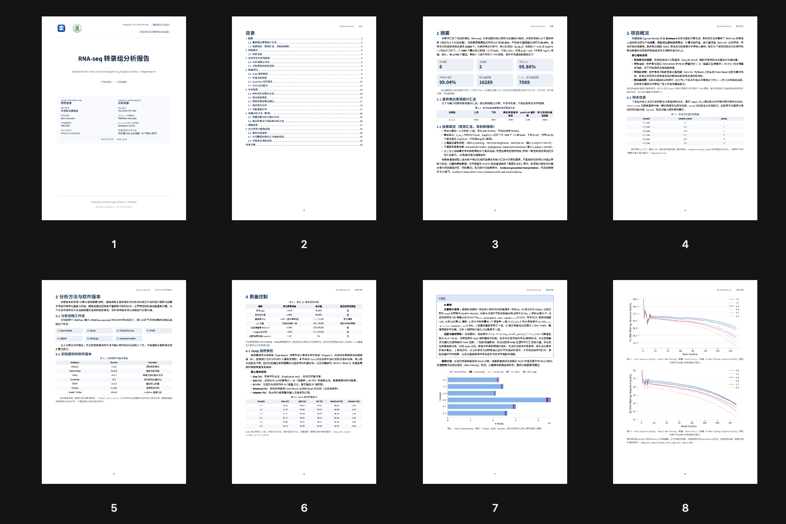
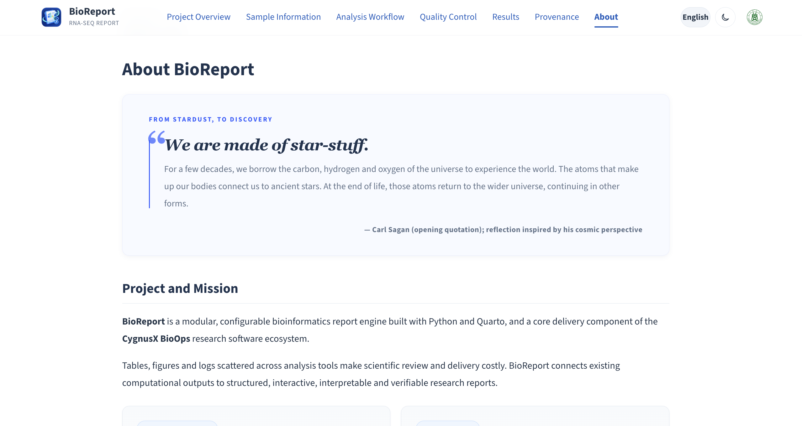
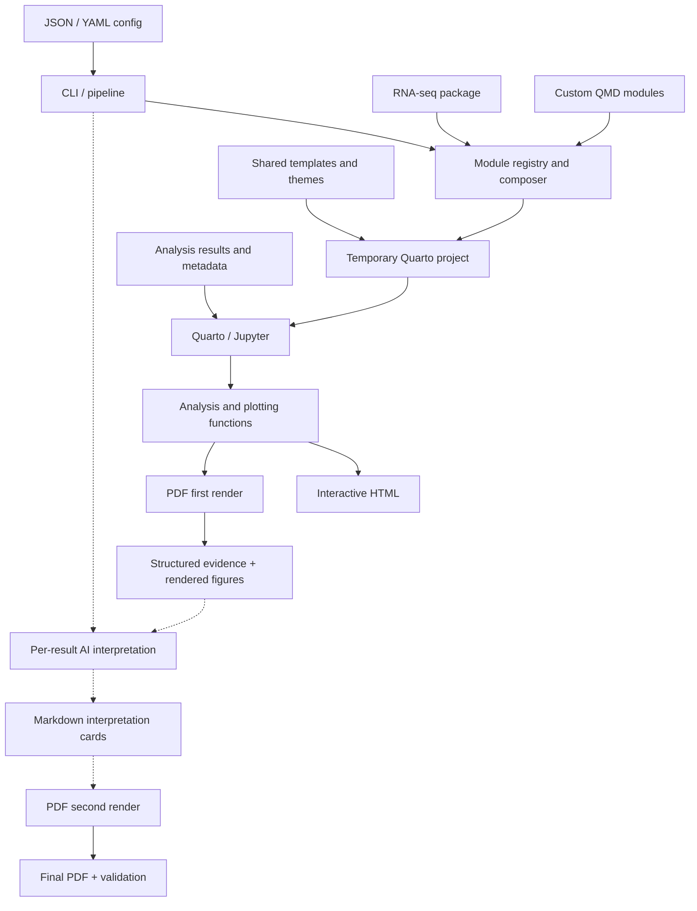

**English** | [中文文档](docs/README.zh-CN.md)

<p align="center">
  
</p>

# BioReport

BioReport is a configuration-driven, modular omics reporting engine built with Python and Quarto. It is part of the [CygnusX BioOps](https://github.com/xsx123123/omichub) ecosystem and currently includes an RNA-seq package for integrating QC, alignment, expression, differential expression, and enrichment results.

The same project configuration can produce interactive HTML and print-ready PDF reports. Optional AI interpretation can be attached to individual tables, figures, comparisons, and enrichment results.





## Features

- **Unified configuration**: JSON or YAML controls report metadata, modules, analysis parameters, AI, and output formats.
- **Composable modules**: Select built-in modules such as `index`, `workflow`, `qc`, `results`, `provenance`, `ai`, and `about`; custom QMD modules can be added through `report.module_definitions`.
- **HTML and PDF delivery**: `report.output_format: [html, pdf]` produces a single-file HTML report and a Typst-based PDF report.
- **Interactive HTML**: Plotly figures and searchable Itables tables are embedded for offline use.
- **Reproducible output**: Input SHA-256 fingerprints, provenance, delivery manifests, configuration backups, and run logs are recorded.
- **AI-assisted interpretation**: Results can be interpreted independently with structured evidence and optional visual input.
- **Docker support**: The image includes Python, Quarto, and the report dependencies.
- **Backward compatibility**: Legacy `project_summary.json` and older YAML layouts remain supported by the config loader.

## Requirements

- [Python 3.10+](https://www.python.org/)
- [Quarto](https://quarto.org/) for local rendering
- RNA dependencies: `pip install -e '.[rna]'`
- AI dependencies: `pip install -e '.[rna,ai]'`
- Optional PDF validation and read-only locking: `pip install -e '.[rna,security,validation]'`
- Kaleido and a supported Chrome/Chromium installation for static figure export
- Docker for containerized execution

## Quick start

Install the package and validate a local RNA-seq configuration:

```bash
pip install -e '.[rna]'
python -m bioreport validate -c tests/report.rna.local.json
```

Generate HTML, PDF, or PDF with per-result AI interpretation:

```bash
python -m bioreport run -c tests/report.rna.html.json -o output/rna-report
python -m bioreport run -c tests/report.rna.pdf.json -o output/rna-report-pdf
python -m bioreport run -c tests/report.rna.pdf.ai.json -o output/rna-pdf-report-ai
```

Use `--dry-run` to validate modules, templates, and input files without calling AI or running Quarto:

```bash
python -m bioreport run -c tests/report.rna.local.json -o output/rna-report --dry-run
```

The default single-file HTML report is written as `<project_id>_report.html`; the PDF is written as `<project_id>_report.pdf`. Set `report.layout: website` for a multi-page HTML site. Website layout cannot be combined with PDF output.

### Run history and Workspace

Run records are stored in `~/.bioreport/runs.db` by default:

```bash
bioreport runs
bioreport runs --project PRJ-RNA --status success --since 2026-01-01 --limit 20
bioreport runs --json
bioreport runs --tui
```

Workspace database migration is explicit and creates a neighboring backup:

```bash
bioreport workspace-migrate --db /path/to/runs.db
bioreport workspace-restore --db /path/to/runs.db
```

### Docker

```bash
docker build -f deploy/Dockerfile -t bioreport:latest .

docker run --rm \
  -v /path/to/data:/data:ro \
  -v /path/to/output:/workspace \
  -v "$(pwd)/configs/report.example.json:/app/configs/report.example.json:ro" \
  bioreport:latest -c /app/configs/report.example.json -o /workspace
```

## PDF reports

RNA-seq PDF reports use dedicated QMD chapters and Typst print styles. They include a cover, table of contents, project and sample information, workflow and methods, QC, expression, differential expression, enrichment, provenance, and delivery notes.

PDF tables are previews; complete result files remain in the configured delivery directory. The PDF path descriptions use relative paths under `input_files.data_dir` and do not expose host absolute paths.

The PDF AI path with `ai.scope: results` runs in two stages:

1. Render the figures and tables once and record `report-blocks-pdf.jsonl`.
2. Bind each result ID to structured evidence and any rendered figure image, then call the model independently.
3. Write the Markdown cards and render the PDF again so each interpretation appears below its corresponding result.

The PDF layout and content validators run after the final render. See [PDF style guidance](docs/info/pdf-style.md).

## Architecture

BioReport separates configuration, module composition, analysis functions, evidence capture, interpretation, and delivery. The authoritative architecture source is [`templates/shared/assets/architecture.mmd`](templates/shared/assets/architecture.mmd); the report About page includes that source. The static PDF SVG must be regenerated when the Mermaid source changes.

See [the architecture guide](docs/Architecture.md) for the implementation details.



## AI configuration

The default `results` scope creates one card for each supported result. The legacy `global` scope creates the old combined interpretation chapter.

| Field | Description |
| :--- | :--- |
| `enabled` | Enable or disable interpretation. |
| `provider` / `model` | Provider alias and model or endpoint ID. |
| `base_url` / `api_key_env` | OpenAI-compatible endpoint and API key environment variable. |
| `temperature` | Sampling temperature. |
| `max_output_tokens` | Per-result output limit; 600–1200 is recommended for cards. |
| `scope` | `results` for independent cards; `global` for the legacy combined chapter. |
| `result_rows` | Maximum CSV rows sent for each result. |
| `prompt_file` | Optional custom system prompt. |
| `vision` / `max_image_bytes` | Visual input switch and per-image size limit. |

All providers use the OpenAI Python SDK. Default API key variables are `ARK_API_KEY` for `volcengine`, `DASHSCOPE_API_KEY` for `aliyun`, and `OPENAI_API_KEY` for `openai-compatible`.

```json
{
  "ai": {
    "enabled": true,
    "provider": "openai-compatible",
    "base_url": "https://llm.example.com/v1",
    "api_key_env": "MY_LLM_API_KEY",
    "model": "provider-model-id",
    "scope": "results"
  }
}
```

### Current AI framework and next version

The current version has established the AI interpretation framework:

- independent result IDs and cards for QC, sample relationships, expression, heatmaps, DEG, and enrichment;
- bounded structured evidence and source-artifact mapping;
- two-stage visual interpretation for PDF reports;
- OpenAI SDK compatibility, retries, input limits, visual fallback, and visible empty-response fallback;
- result slots ready to record evidence hashes, prompt versions, model parameters, and response status.

The next version will focus on prompt and interpretation quality rather than changing the report rendering pipeline. Prompts will be specialized for fastp/QC, sample relationships, DEG, enrichment, and visual chart reading. The target output structure is: observations, statistical evidence, biological interpretation, limitations, and review items. Numeric references, evidence consistency, and empty-result validation will be strengthened. The implementation skeleton is tracked in [`todo.md`](todo.md).

## Project structure

```text
bioreport/
├── bioreport/                  # Core engine and CLI
│   ├── cli.py                  # Command-line orchestration
│   ├── config.py               # Config loading and normalization
│   ├── modules.py              # Module composition
│   ├── renderer.py             # Quarto staging and templates
│   ├── pipeline.py             # AI pipeline
│   ├── ai/                     # Providers, evidence, validation, persistence
│   ├── report/                 # PDF semantic model and validation
│   └── utils/                  # Rendering, provenance, fonts, PDF helpers
├── omics/rna/                 # RNA-seq modules and shared analysis functions
├── templates/                 # Shared QMD pages, themes, PDF styles, assets
├── configs/                   # Example configurations
├── examples/                  # RNA-seq and generic assay examples
├── tests/                     # Unit and integration tests
├── docs/README.zh-CN.md       # Chinese version of this README
└── deploy/Dockerfile          # Container image definition
```

## Output and extension boundaries

- The active generation path uses `bioreport/`, `omics/rna/`, and `templates/`; `archive/` is not part of the current pipeline.
- `single` layout combines selected QMD modules and embeds HTML resources; `website` renders independent HTML pages.
- Built-in `qc.*` and `results.*` modules use RNA-seq data contracts. Other assays can use `report.module_definitions` with custom QMD files and parameters.
- HTML figures and tables are emitted through shared display helpers. PDF figures use static SVG export and Typst layout.
- New omics packages should register modules, provide QMD templates and analysis functions, and add package data as needed.

## Workspace v1

The local Workspace exposes historical runs, evidence, artifacts, provenance, and module-level interpretations:

```bash
pip install -e '.[web]'
BIOREPORT_DB=/path/to/runs.db \
BIOREPORT_TRUSTED_ROOT=/approved/report/root \
python -m bioreport.api_server --host 127.0.0.1 --port 8000
```

Start the frontend separately:

```bash
cd frontend
npm install
npm run dev -- --host 127.0.0.1 --port 5174
```

The API defaults to loopback. Public deployment requires an API token, trusted project configuration, and a reverse proxy. Details are in [`docs/architecture/`](docs/architecture/).

## Validation and tests

```bash
bioreport validate -c <config>
bioreport run -c <config> -o <output> --dry-run
pip install -e '.[rna,dev]'
python -m pytest -q tests -k "not integration"
RUN_REPORT_INTEGRATION=1 python -m pytest -q tests/test_integration_render.py
```

Complete rendering tests require a working Jupyter kernel and Kaleido/Chrome. Each run writes a detailed log named `<project_id>_<time>_bioreport.log` to the output directory.

## FAQ

- **AI output is missing**: ensure the AI module is selected, `ai.enabled` is true, dependencies are installed, the API key is available, and the model ID is valid.
- **Path errors**: local relative paths are resolved from the config directory and `data_dir`; Docker configs must use paths inside the container.
- **Unexpected modules**: update `report.modules` and rerun the command.

## Version and acknowledgements

Current version: **v2.0.0**

Maintainer: **Zhang Jian**

The project welcomes issue reports and module contributions through GitHub. The BioReport/CygnusX BioOps team thanks the research teams who contributed analysis requirements and testing feedback.
