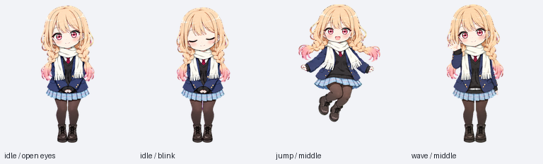
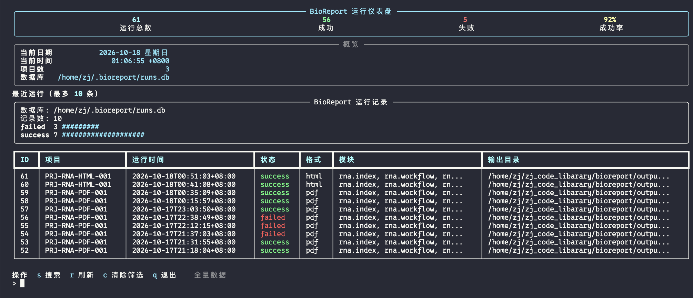
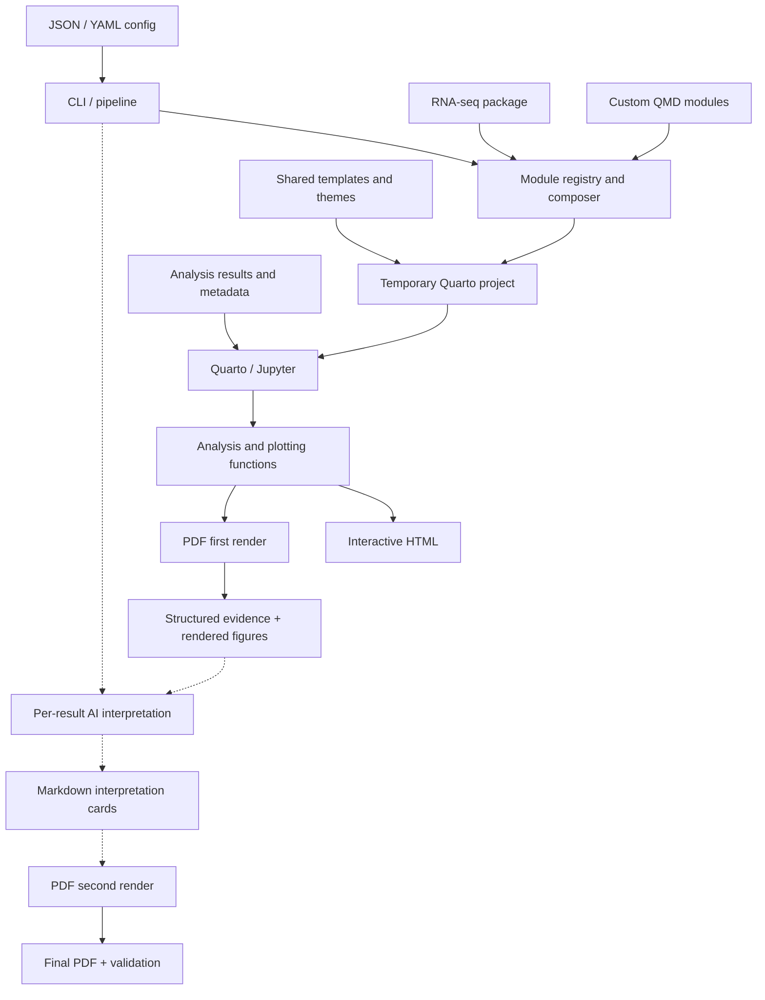

**English** | [中文文档](docs/README.zh-CN.md) | [Documentation index](docs/README.md)

<p align="center">
  
</p>

# BioReport

[](https://github.com/xsx123123/bioreport/actions/workflows/ci.yml) [](https://github.com/xsx123123/bioreport/releases)

BioReport is a configuration-driven, modular omics reporting engine built with Python and Quarto. It is part of the [CygnusX BioOps](https://github.com/xsx123123/omichub) ecosystem and currently includes an RNA-seq package for integrating QC, alignment, expression, differential expression, and enrichment results.

The same project configuration can produce interactive HTML and print-ready PDF reports. Optional AI interpretation can be attached to individual tables, figures, comparisons, and enrichment results.


## Features

- **Unified configuration**: JSON or YAML controls report metadata, modules, analysis parameters, AI, and output formats.
- **RNAFlow delivery contract**: [JSON specification](docs/RNAFlow-JSON规范.md), [standalone Schema](configs/rnaflow.delivery.schema.json), and [lightweight example](configs/report.rnaflow.example.json) define portable GO/KEGG CSV references and inline software versions.
- **Composable modules**: The engine composes shared modules such as `index`, `workflow`, `provenance`, `ai`, and `about`. The built-in `qc.*` and `results.*` modules, including `qc.fastp`, `results.deg`, and `results.enrichment`, are currently RNA-seq-specific. Other omics workflows can use external QMD modules through `report.module_definitions`; native modules, data contracts, and analysis components for additional omics types are planned.
- **HTML and PDF delivery**: The engine supports `report.output_format: [html, pdf]` for HTML and Typst-based PDF delivery. The current RNA-seq single-page template exposes six navigable pages; other omics types will use the same delivery interface with their own chapter templates.
- **Interactive HTML**: Plotly figures and searchable Itables tables are embedded for offline use.
- **Optional desktop pet**: HTML reports can include the Taotao animated desktop pet, with click and drag interactions. It is disabled by default; add `report.pet.enabled: true` to opt in.
- **Report variants**: The same data and code can produce full, compact, or AI-disabled reports through module and PDF settings.
- **Reproducible delivery**: Input SHA-256 fingerprints, provenance, delivery manifests, configuration backups, engine metadata, module lists, and run logs are recorded; final artifacts are re-hashed and validated.
- **Report history and evidence**: Workspace/API endpoints expose historical runs, artifacts, evidence packages, provenance, and module-level interpretation status with integrity and availability information.
- **Per-result AI interpretation**: QC, sample relationships, expression, heatmaps, DEG, and enrichment outputs receive independent Markdown interpretation cards linked to their source evidence.
- **PDF visual interpretation**: For `ai.scope: results`, PDF generation renders figures first, sends rendered images plus structured evidence to the model, and performs a second render to place cards below the corresponding result; structured evidence is used as a fallback when an image cannot be prepared.
- **Auditable AI integration**: Providers use the OpenAI Python SDK with retries, input limits, fallback providers, visual fallback, and empty-response handling; result slots can record evidence hashes, prompt versions, model parameters, and response status.
- **Docker image**: A pinned Quarto 1.8.26 image includes the report dependencies and runs an RNA HTML/PDF smoke test during the build.
- **Backward compatibility**: Legacy `project_summary.json` and older YAML layouts remain supported by the config loader.

## Next-stage priorities

The next stage will focus on three areas: formalizing container delivery and mount conventions; evolving the current per-result AI framework with specialized prompts, evidence validation, auditable agents, and asynchronous Workspace interpretation; and adding native modules, data readers, analysis functions, and report templates for additional omics types. See [`docs/roadmap.md`](docs/roadmap.md) and [`docs/AI.md`](docs/AI.md) for the roadmap.

## Requirements

- [Python 3.10+](https://www.python.org/)
- [Quarto](https://quarto.org/) for local rendering
- RNA reporting and AI Python dependencies: `python -m pip install -e ./` (the historical `rna` and `ai` extras remain accepted)
- Optional PDF validation and read-only locking: `pip install -e '.[rna,security,validation]'`
- Kaleido and a supported Chrome/Chromium installation for static figure export
- Docker: see the commands below and [`deploy/README.zh-CN.md`](deploy/README.zh-CN.md) for deployment details.

## Quick start

Install the package and validate a local RNA-seq configuration:

```bash
python -m pip install -e ./
python -m bioreport validate -c tests/report.rna.local.json
```

Generate HTML, PDF, or PDF with per-result AI interpretation:

```bash
python -m bioreport run -c tests/report.rna.html.json -o output/rna-report
python -m bioreport run -c tests/report.rna.pdf.json -o output/rna-report-pdf
python -m bioreport run -c tests/report.rna.pdf.ai.json -o output/rna-pdf-report-ai
```

PDF DEG and enrichment figures are prepared in **8 worker processes by default**. Workers read and filter individual results, draw figures, and export independent SVGs. The main process preserves comparison/database/direction order while assigning figure numbers and emitting tables, AI cards, and evidence records. HTML and final Typst document composition retain their existing execution flow.

The terminal keeps the module progress and adds live `plots` (prepared results) and `results` (ordered report output) bars, including the current comparison. Enrichment counts database/comparison/direction entries; output also counts missing, disabled, and empty result notices, so the two totals may differ. A separate progress file updates the terminal while Jupyter is still capturing cell output.

Set `report.pdf.workers` in JSON/YAML, or override it with `--workers` (`-t` and `--threads` are aliases for the same **process count**). Use `1` for serial preparation. The pool starts at most one process per available task, limits in-flight tasks, and uses one BLAS/OpenMP thread per worker.

```bash
python -m bioreport run -c report.json -o output/report --workers 8
python -m bioreport run -c report.json -o output/report-serial --workers 1
```

```json
{"report": {"pdf": {"workers": 8}}}
```

Dense scatter plots with more than 1000 points embed the complete point layer at 400 dpi inside SVGs; axes, threshold lines, and gene annotations remain vector graphics. Table continuation checks query only the current table's first row to reduce memory use in large reports.

Failed renders log the exit code and preserve the staged project under `failed-render/<run directory>/` in the output directory. If Typst source exists, run the logged `sh .../templates/compile-pdf.sh` command to compile existing figures without repeating Python or AI. The resulting `templates/recovered.pdf` is a typesetting recovery artifact; delivery validation, metadata processing, and PDF protection are not applied by this command.

Use `--dry-run` to validate modules, templates, and input files without calling AI or running Quarto:

```bash
python -m bioreport run -c tests/report.rna.local.json -o output/rna-report --dry-run
```

## Optional Taotao desktop pet

HTML reports can optionally include Taotao as an interactive desktop pet. The
pet is disabled by default and is added only when `report.pet.enabled` is set
to `true`. It is embedded in HTML as an offline resource; PDF output does not
include it. Click or double-click Taotao to trigger an animation, or drag it
to another position in the report.



Enable it in a JSON or YAML report configuration:

```json
{
  "report": {
    "pet": {
      "enabled": true,
      "size": 144
    }
  }
}
```

`size` accepts values from 96 to 240 pixels. A ready-to-run configuration for
the X101SC26098749-Z01-J001 example is included at
`tests/X101SC26098749-Z01-J001.pet.json`:

```bash
python -m bioreport run \
  -c tests/X101SC26098749-Z01-J001.pet.json \
  -o output/X101SC26098749-Z01-J001-pet
```

For Docker, use the same repository mount as the X101 example and point the
container at the pet-enabled configuration:

```bash
mkdir -p "$PWD/output/X101SC26098749-Z01-J001-pet"
docker run --rm -it \
  -v "$PWD:/project:ro" \
  -v "$PWD/output/X101SC26098749-Z01-J001-pet:/workspace" \
  bioreport:latest run \
  -c /project/tests/X101SC26098749-Z01-J001.pet.json \
  -o /workspace
```

For RNA-seq reports in `single` layout, `<project_id>_report.html` contains both Chinese and English, with a button to switch languages within the same file. PDFs are delivered separately as `<project_id>_report.pdf` (Chinese) and `<project_id>_report.en.pdf` (English), with evidence and validation manifests. Set `report.title_en` to customize the English title. Set `report.layout: website` for a multi-page HTML site with separate language editions; website layout cannot be combined with PDF output.

### Run history and Workspace

Run records are stored in `~/.bioreport/runs.db` by default:

```bash
bioreport runs
bioreport runs --project PRJ-RNA --status success --since 2026-01-01 --limit 20
bioreport runs --json
bioreport runs --tui
```



Workspace database migration is explicit and creates a neighboring backup:

```bash
bioreport workspace-migrate --db /path/to/runs.db
bioreport workspace-restore --db /path/to/runs.db
```

## Docker and PDF deployment

### Build, test, and run with Make

Run these commands from the repository root. The Makefile reads `[project].version` from `pyproject.toml` each time Make is invoked and uses `IMAGE=bioreport:<version>` by default. With the current version, `0.2.1`, the following command builds `bioreport:0.2.1`:

```bash
make docker-build
```

This expands to `docker build --platform linux/amd64 -f deploy/Dockerfile -t bioreport:0.2.1 .`. The build pins Quarto 1.8.26 and automatically checks the installed package, Kaleido export, and RNA HTML/PDF report generation. Changing the version in `pyproject.toml` changes the default image tag on the next invocation; rebuild the image before testing or running that version.

`docker-test` and `docker-run` use the same default versioned image. They require an existing image and do not build it automatically:

```bash
make docker-test
make docker-run
```

| Target | Behavior |
| --- | --- |
| `make docker-build` | Build the current source using `deploy/Dockerfile`, tagged with the project version. |
| `make docker-test` | Run `/opt/bioreport-smoke-test.py` in the selected image to check the installed package and HTML/PDF rendering. |
| `make docker-run` | Create `OUT` if necessary, mount `CONFIG` and `DATA` read-only, and generate reports in `OUT` using the selected image. |

The Make variables below can be set as `make <target> NAME=value`:

| Variable | Default | Meaning |
| --- | --- | --- |
| `IMAGE` | `bioreport:<version>` | Image name and tag used by all three Docker targets. |
| `PLATFORM` | `linux/amd64` | Build platform; the current Dockerfile downloads an amd64 Quarto package, so use this default. |
| `CONFIG` | `configs/report.example.json` | Host configuration file mounted at `/config/report.json` by `docker-run`. |
| `DATA` | `examples/rna-seq/data` | Host input directory mounted at `/data` read-only by `docker-run`. |
| `OUT` | `output` | Host output directory mounted at `/workspace` with write access by `docker-run`. |

For example, generate a report with a different configuration and data directory:

```bash
make docker-run \
  CONFIG=/path/to/report.json \
  DATA=/path/to/project-data \
  OUT=/path/to/report-output
```

For `make docker-run`, set `input_files.data_dir` in the configuration to `/data`, with input file paths relative to that directory. The X101SC26098749-Z01-J001 configuration preserves a different relative directory structure; use its repository-mount command below.

To use the `bioreport:latest` tag in the examples below, specify `IMAGE` for **each** Make invocation:

```bash
make docker-build IMAGE=bioreport:latest
make docker-test IMAGE=bioreport:latest
make docker-run IMAGE=bioreport:latest
```

An `IMAGE` override applies only to that invocation. A later plain `make docker-test` or `make docker-run` uses `bioreport:<version>` again. The default build creates only the versioned tag; it does not also create or update `bioreport:latest`.

### Generate the X101SC26098749-Z01-J001 report

From the repository root, the following command is equivalent to `python -m bioreport run -c tests/X101SC26098749-Z01-J001.json -o "$PWD/output/X101SC26098749-Z01-J001"`. It requires the example configuration and data to exist in your checkout. Create the output directory, then run:

```bash
mkdir -p "$PWD/output/X101SC26098749-Z01-J001"

docker run --rm -it \
  -v "$PWD:/project:ro" \
  -v "$PWD/output/X101SC26098749-Z01-J001:/workspace" \
  bioreport:latest run \
  -c /project/tests/X101SC26098749-Z01-J001.json \
  -o /workspace
```

| Argument | Meaning |
| --- | --- |
| `docker run` | Create and start a container using the specified image. |
| `--rm` | Remove the container after it exits. Files written to the mounted output directory remain on the host. |
| `-it` | Keep standard input open and allocate a terminal for interactive use and progress display. Omit this option in CI or other non-interactive jobs. |
| `-v "$PWD:/project:ro"` | Mount the current repository directory at `/project` inside the container. `$PWD` must be the repository root; `:ro` makes this mount read-only. This exposes both `tests/` and `examples/` while preserving their relative paths. |
| `-v "$PWD/output/X101SC26098749-Z01-J001:/workspace"` | Mount the host output directory at `/workspace` with write access, so reports and logs persist after the container exits. |
| `bioreport:latest` | Select the Docker image. Replace it with `bioreport:0.2.1` when using the current versioned image built by `make docker-build`; use the corresponding version after updating `pyproject.toml`. |
| `run` | Generate a report. The image entrypoint is `bioreport`, so this invokes `bioreport run` inside the container. |
| `-c /project/tests/X101SC26098749-Z01-J001.json` | Load the report configuration from its container path. Its `input_files.data_dir`, `../examples/X101SC26098749-Z01-J001/data`, resolves relative to the configuration file directory. |
| `-o /workspace` | Write the generated reports and logs to the container output mount, corresponding to `output/X101SC26098749-Z01-J001/` on the host. |

The repository mount supplies configuration and input data; BioReport itself runs from the installed package in the image. Rebuild the image after changing the source code.

During rendering, Quarto writes intermediate files such as `qmd/report.html` and `qmd/report_pdf.pdf` beneath the output directory. BioReport then moves and renames them using the project ID. For single-file RNA-seq HTML, the Chinese and English editions are staged, merged into `<project_id>_report.html`, and removed as separate files. PDFs remain separate Chinese and English deliverables. The run log records the render output, each move/rename, the HTML merge, and PDF delivery readiness. Short paths in these messages are relative to the output directory; the final summary shows the delivery locations.

### Use separate configuration and data mounts

To generate a report, mount a configuration, its input data, and an output directory. Paths inside the configuration must point to the container mount points, for example `/data` and `/workspace`:

```bash
docker run --rm \
  -v "$PWD/report.json:/config/report.json:ro" \
  -v /path/to/project-data:/data:ro \
  -v /path/to/report-output:/workspace \
  bioreport:latest run -c /config/report.json -o /workspace
```

The configuration's `input_files.data_dir` should be `/data` (or a path beneath it). The generated HTML/PDF files will appear in `/path/to/report-output`. See [`deploy/README.zh-CN.md`](deploy/README.zh-CN.md) for complete examples and PDF deployment details.

## Architecture

BioReport separates configuration, module composition, analysis functions, evidence capture, interpretation, and delivery. The authoritative architecture source is [`templates/shared/assets/architecture.mmd`](templates/shared/assets/architecture.mmd); the report About page includes that source. The static PDF SVG must be regenerated when the Mermaid source changes.

See [the architecture guide](docs/Architecture.md) for the implementation details.



## AI configuration and roadmap

The JSON/YAML configuration already reserves compatibility fields for AI providers and future workflows, including `enabled`, `provider`, `model`, `base_url`, `api_key_env`, `scope`, `vision`, input limits, and fallback settings. Detailed field definitions and the current interpretation pipeline are maintained in [`docs/AI.md`](docs/AI.md).

The current release provides the per-result interpretation framework. The next version will focus on specialized prompts, evidence constraints, output validation, audit fields, and asynchronous AI interpretation in Workspace v2. See [`docs/AI.md`](docs/AI.md) and [`docs/roadmap.md`](docs/roadmap.md) for the roadmap.

## Project structure

```text
bioreport/
├── bioreport/                  # Core engine and CLI
│   ├── cli.py                  # Command-line orchestration
│   ├── config.py               # Config loading and normalization
│   ├── modules.py              # Module composition
│   ├── renderer.py             # Quarto staging and templates
│   ├── pipeline.py             # AI pipeline
│   ├── ai/                     # Providers, evidence, validation, persistence
│   ├── report/                 # PDF semantic model and validation
│   └── utils/                  # Rendering, provenance, fonts, PDF helpers
├── omics/rna/                 # RNA-seq modules and shared analysis functions
├── templates/                 # Shared QMD pages, themes, PDF styles, assets
├── configs/                   # Example configurations
├── examples/                  # RNA-seq and generic assay examples
├── tests/                     # Unit and integration tests
├── docs/README.zh-CN.md       # Chinese version of this README
└── deploy/Dockerfile          # Container image definition
```

## Output and extension boundaries

- The active generation path uses `bioreport/`, `omics/rna/`, and `templates/`; `archive/` is not part of the current pipeline.
- `single` layout combines selected QMD modules and embeds HTML resources; `website` renders independent HTML pages.
- Built-in `qc.*` and `results.*` modules use RNA-seq data contracts. Other assays can use `report.module_definitions` with custom QMD files and parameters.
- HTML figures and tables are emitted through shared display helpers. PDF figures use static SVG export and Typst layout.
- New omics packages should register modules, provide QMD templates and analysis functions, and add package data as needed.

## Workspace v1 and Web roadmap

The current Workspace v1 exposes historical runs, evidence, artifacts, provenance, and module-level interpretations. The static HTML/PDF reports remain the primary delivery format; a complete AI workbench is planned for Workspace v2.

```bash
pip install -e '.[web]'
BIOREPORT_DB=/path/to/runs.db \
BIOREPORT_TRUSTED_ROOT=/approved/report/root \
python -m bioreport.api_server --host 127.0.0.1 --port 8000
```

Start the frontend separately:

```bash
cd frontend
npm install
npm run dev -- --host 127.0.0.1 --port 5174
```

The API defaults to loopback. Public deployment requires an API token, trusted project configuration, and a reverse proxy. Details are in [`docs/architecture/`](docs/architecture/).

Workspace v2 will connect projects, runs, analysis modules, evidence, per-result AI interpretations, and delivery versions in one workflow. Planned capabilities include asynchronous interpretation, evidence-linked re-interpretation, version history, and precise HTML/PDF card backfill. See [`docs/roadmap.md`](docs/roadmap.md) for the roadmap.

## Validation and tests

`validate` checks JSON/YAML schema, selected modules, required input keys and paths (existence, readability, and file/directory types for `_file`/`_dir` keys). Optional inputs declared by selected modules are checked when configured; unrelated missing inputs produce warnings. Relative paths resolve against `input_files.data_dir`, or the configuration directory when omitted. It does not inspect file contents or execute Quarto/AI; use `run --dry-run` to also check template assembly.

RNA QC sections (fastp, FastQ Screen, QualiMap, and STAR statistics) tolerate missing input paths. If a section's inputs are absent or unconfigured, HTML/PDF reports show a missing-data notice and continue with the remaining sections. FastQ Screen requires both R1 and R2; if either is missing, the entire screening section is skipped. Logs and provenance record skipped sections. Existing inputs with an invalid type or insufficient read permissions still fail validation, as do missing core analysis inputs such as the expression matrix.

```bash
bioreport validate -c <config>
bioreport run -c <config> -o <output> --dry-run
pip install -e '.[rna,dev]'
python -m pytest -q tests -k "not integration"
RUN_REPORT_INTEGRATION=1 python -m pytest -q tests/test_integration_render.py
```

Complete rendering tests require a working Jupyter kernel and Kaleido/Chrome. Each run writes a detailed log named `<project_id>_<time>_bioreport.log` to the output directory.

## FAQ

- **AI output is missing**: ensure the AI module is selected, `ai.enabled` is true, dependencies are installed, the API key is available, and the model ID is valid.
- **Path errors**: local relative paths are resolved from the config directory and `data_dir`; Docker configs must use paths inside the container.
- **Unexpected modules**: update `report.modules` and rerun the command.

## Version and acknowledgements

Current version: **v0.2.1**. See [`CHANGELOG.md`](docs/CHANGELOG.md) for release history. See [`CONTRIBUTING.md`](docs/CONTRIBUTING.md) for contribution guidelines.

Maintainer: **Zhang Jian**

The project welcomes issue reports and module contributions through GitHub. The BioReport/CygnusX BioOps team thanks the research teams who contributed analysis requirements and testing feedback.

<p align="center">
  
</p>
