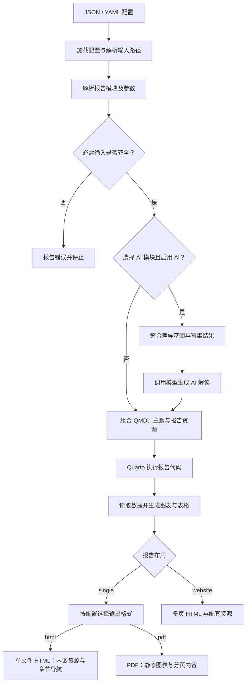

<p align="center">
  
</p>

# BioReport (多组学 Quarto 报告生成系统)

当前入口是 `bioreport` 或 `python -m bioreport`，支持 `run`、`validate` 和 `init`。不带参数时会显示帮助。核心引擎位于 `bioreport/`，RNA 内容与分析代码位于 `omics/rna/`，共享模板与主题位于 `templates/`。

Docker 镜像由 `deploy/Dockerfile` 构建；`Makefile` 提供安装、验证、测试和构建命令。

## 📖 项目简介

BioReport 是基于 **Python** 和 **Quarto** 的组学报告生成器。目前提供 RNA-seq 模块，可整合 fastp、比对、差异表达和富集分析结果；配置中启用 AI 模块时可加入模型解读。报告模块可按配置组合。仓库的 RNA-seq 完整示例和通用分析示例配置输出单文件 HTML 与 PDF；本地 RNA 示例仅输出 HTML。默认 RNA-seq 模块组合在 HTML 中提供六个可切换的章节视图。

使用统一的 JSON 或 YAML 配置控制报告标题、章节、AI 开关、分析参数和输出格式。

## ✨ 核心功能

- **统一配置**：JSON 或 YAML 驱动报告类型、标题、导航、章节、AI、分析参数等。
- **JSON 输入**：`configs/report.example.json` 展示相同配置结构，`bioreport/report.schema.json` 定义字段类型与参数范围；`input_files` 中的相对路径以 `data_dir` 为根。
- **模块组合**：`report.modules` 按顺序引用 `index`、`workflow`、`qc`、`results`、`ai`、`about` 等内容模块；单页模式可单独引用 `qc.fastp`、`qc.screen`、`qc.qualimap`、`qc.star` 和 `results.samples`、`results.matrix`、`results.heatmap`、`results.deg`、`results.enrichment`，也可通过 `report.module_definitions` 引用外部 QMD。
- **双格式输出**：`report.output_format: [html, pdf]` 生成 HTML 和 PDF；RNA-seq 的 HTML 在一个文件内按导航切换六个页面，PDF 图表使用静态图。
- **多报告变体**：同一套数据和代码，可输出完整版、精简版、无 AI 版等不同报告。
- **自动化流程**：按配置执行数据检查、可选 AI 解读及 Quarto 渲染。
- **AI 智能解读**：利用大语言模型（LLM）对差异基因和富集通路进行生物学功能分析。
- **交互式报告**：基于 Quarto 生成，包含 Plotly 交互图表、Itables 数据表格。
- **Docker 容器化**：在镜像中提供 Python、Quarto 和报告依赖，便于部署。
- **向后兼容**：旧版 `project_summary.json` 仍可运行。

## 🛠️ 环境依赖

- [Python 3.10+](https://www.python.org/)；本地运行需安装 [Quarto](https://quarto.org/)
- RNA 报告依赖：`pip install -e '.[rna]'`
- AI 解读需额外安装 AI 依赖：`pip install -e '.[rna,ai]'`
- PDF 图表通过 Kaleido 导出为图片；所用 Kaleido 版本若依赖 Chrome / Chromium，需在运行环境提供浏览器
- Docker 运行需 Docker；镜像内已安装 Python、Quarto 和报告依赖

## 🚀 快速上手

### 本地生成 RNA 示例报告

```bash
pip install -e '.[rna]'
python -m bioreport validate -c tests/report.rna.local.json
python -m bioreport run -c tests/report.rna.local.json -o output/rna-report
```

示例数据位于 `examples/rna-seq/data/`，本地配置在 `tests/report.rna.local.json`，默认使用 `single` 模式，生成 `output/rna-report/report.html`，样式、脚本及图片资源嵌入 HTML。报告内通过顶部导航切换六个章节视图。页面使用 `templates/theme/New_Brutalism.scss`、`styles.css` 和 `itables_saas.css`；修改模板或 Logo 后重新生成即可更新。若需要六份独立 HTML，可将 `report.layout` 改为 `website`，从 `output/rna-report/index.html` 打开。先用 `--dry-run` 可检查配置和模板组合，此模式不生成 HTML。`configs/report.example.json` 的数据根目录为容器内 `/data`，本地直接运行前须修改路径。

需要单文件 HTML/PDF 时，将 `report.layout` 设为 `"single"`，并按需设置 `report.output_format`。修改报告章节内容请编辑 `omics/rna/qmd/`，调整共享样式请编辑 `templates/theme/`；报告默认使用其中的白色背景亮色主题和 CSS。报告标题、模块顺序、分析阈值等由配置文件控制。

### Docker 生成报告

#### 1. 构建 Docker 镜像

在仓库根目录执行：

```bash
docker build -f deploy/Dockerfile -t bioreport:latest .
```

#### 2. 准备配置文件

推荐使用统一 JSON 配置文件。项目已提供三个示例：

| 配置文件 | 说明 |
| :--- | :--- |
| `configs/report.example.json` | 完整版 RNA 报告配置，使用容器内 `/data` |
| `configs/report.generic.json` | 通用 assay 示例，使用仓库内的示例数据 |
| `tests/report.rna.local.json` | 本地 RNA 示例，使用仓库内的示例数据 |

你可以复制其中一个并根据实际项目修改 `project` 与 `input_files` 部分。

#### 3. 运行报告生成
使用 Docker 运行系统（请根据实际路径修改 `-v` 挂载）：

```bash
# 完整版报告
docker run --rm \
  -v /你的/本地/数据目录:/data:ro \
  -v /你的/本地/输出目录:/workspace \
  -v "$(pwd)/configs/report.example.json:/app/configs/report.example.json:ro" \
  bioreport:latest -c /app/configs/report.example.json -o /workspace

# 通用 assay 报告（需挂载配置及示例数据）
docker run --rm \
  -v "$(pwd)/examples/generic-assay:/app/examples/generic-assay:ro" \
  -v "$(pwd)/configs:/app/configs:ro" \
  -v /你的/本地/输出目录:/workspace \
  bioreport:latest -c /app/configs/report.generic.json -o /workspace
```

RNA-seq 报告为 `/workspace/report.html` 和 `/workspace/report.pdf`。分享 HTML 时只需要一个文件，导航在文件内切换页面。HTML 会内嵌 Quarto、Plotly 和 ITables 的运行资源；普通超链接仍可指向外部文献或网站。若只要一种格式，将 `output_format` 设为 `"html"` 或 `"pdf"`。`report.layout: website` 保留多页 HTML，不能与 PDF 同时使用。

#### 4. 干运行（仅渲染模板，不执行 Quarto）
用于快速检查配置和模板渲染是否正确；此模式不检查输入文件是否存在：

```bash
docker run --rm \
  -v "$(pwd)/configs/report.example.json:/app/configs/report.example.json:ro" \
  bioreport:latest -c /app/configs/report.example.json -o /workspace --dry-run
```

## 🔄 报告生成流程

BioReport 根据 JSON / YAML 配置解析输入路径、选择报告模块并检查必需文件。选择 AI 模块且启用 AI 时，系统先整合分析结果并生成解读，再通过 Quarto 执行报告代码、生成图表与表格，按配置输出 HTML 和 PDF。



- **单文件模式**（`report.layout: single`）：支持 HTML、PDF 或同时输出两种格式；默认 RNA-seq HTML 提供六个可切换的章节视图，内容与顺序由模块配置控制。
- **网站模式**（`report.layout: website`）：输出多页 HTML 与配套资源，不与 PDF 同时使用。
- **PDF 输出**：从组合后的报告内容通过 Quarto / Typst 渲染，交互图表转换为静态图片。
- **干运行**（`--dry-run`）：用于检查配置与模板组合，不执行 Quarto，不生成最终 HTML / PDF。

以上流程图展示生成过程的逻辑关系。

## 📂 目录结构说明

```text
.
├── bioreport/                   # 组学无关核心引擎与 CLI
│   ├── __init__.py
│   ├── __main__.py              # 支持 python -m bioreport
│   ├── cli.py                   # CLI 解析与主流程编排
│   ├── config.py                # YAML/JSON 统一配置加载 + 项目元数据
│   ├── report.schema.json       # 报告配置字段与取值约束
│   ├── registry.py              # 组学模块注册表与模块契约
│   ├── modules.py               # 通用模块组合与兼容别名
│   ├── renderer.py              # Jinja2 模板渲染
│   ├── pipeline.py              # AI 分析流程封装
│   ├── ai/                      # AI 调用引擎
│   │   ├── engine.py
│   │   └── schemas.py
│   └── utils/                   # 工具脚本
│       ├── consolidate_rna_seq_data.py
│       ├── setup_report.py
│       ├── visualize_utils.py
│       ├── report_utils.py
│       └── prompt.txt
├── omics/rna/                   # RNA-seq 模块、QMD 与分析脚本
│   ├── modules.py               # RNA 模块声明与输入契约
│   ├── qmd/
│   └── analysis/
├── templates/                   # 通用 Quarto 壳、主题与资源
│   ├── _quarto.yml.j2           # Quarto 网站配置 Jinja2 模板
│   ├── _quarto-single.yml.j2    # 单页 HTML/PDF 配置模板
│   ├── theme/
│   └── logo/
├── configs/                     # 报告配置文件
│   ├── report.example.json
│   └── report.generic.json
├── examples/                    # RNA 与通用 assay 示例数据
├── tests/                       # 单元、交付布局与可选集成测试
├── archive/                     # 旧版演示与运行产物归档，不参与运行
├── pyproject.toml               # Python 包配置
├── deploy/Dockerfile             # 唯一 Docker 交付定义
└── README.md                    # 项目说明文档
```

## 📝 配置文件 (`configs/report.example.json`) 关键字段

### `report` — 报告级设置

| 字段 | 说明 |
| :--- | :--- |
| `type` | 报告类型标识，例如 `rna-seq`；实际内容由 `modules` 控制 |
| `title` | 报告主标题 |
| `language` | 报告语言，例如 `zh` / `en` |
| `output_format` | `html`、`pdf` 或 `[html, pdf]` |
| `layout` | `single`（默认）或 `website`（多页 HTML） |
| `modules` | 内容模块 ID 列表，决定单页中的内容与顺序；`qc`、`results` 可分别替换为对应的子模块；旧 `sections` 字段仍可使用 |
| `module_definitions` | 自定义模块 ID 到 QMD 路径、标题、`params` 和必需输入的映射；路径相对配置文件所在目录 |
| `theme` | HTML 报告的亮色主题路径；省略时使用 `templates/theme/` 中的默认主题，路径相对临时 Quarto 项目根目录 |
| `css` | HTML 报告的 CSS 文件列表；省略时使用 `templates/theme/styles.css` 和 `itables_saas.css`，路径相对临时 Quarto 项目根目录 |
| `logo` | 网站模式中的 Logo 图片路径 |
| `logo_href` | 网站模式中的 Logo 点击链接 |
| `announcement` | 网站模式中的顶部公告，设为 `null` 可关闭 |

单文件 HTML 的两个 Logo 在组合模板中定义，分别链接到 [BioReport 仓库](https://github.com/xsx123123/bioreport) 和 [华中农业大学官网](https://www.hzau.edu.cn/)。

自定义模块示例：

```json
{
  "report": {
    "layout": "single",
    "modules": ["custom.finding"],
    "module_definitions": {
      "custom.finding": {
        "path": "modules/finding.qmd",
        "title": "发现",
        "params": {"input_key": "measurements"},
        "required_inputs": ["measurements"]
      }
    }
  },
  "input_files": {"data_dir": "/data", "measurements": "measurements.csv"}
}
```

外部 QMD 可在代码块中通过 `REPORT_CONFIG` 读取输入数据；静态图片路径应为绝对路径，Quarto 才能在临时组合目录中找到并内嵌它们。
配置 `params` 时，组合器在模块内容前设置 `report_module = {"id": 模块ID, "params": 配置参数}`；同一 QMD 可用不同模块 ID 和参数引用多次。自定义模块中的 `#| label:` 及对应 `@标签` 引用会按模块区分，避免重复引用时发生标签冲突。模块内的相对 `include` 会按原 QMD 所在目录递归展开，循环引用会报错。
使用 Docker 时，应把包含 JSON 和 `modules/` 的目录整体挂载进容器，使相对模块路径在容器内仍然存在。

`examples/generic-assay/` 提供非 RNA 示例：同一份 QMD 在 JSON 中被引用两次，每次通过 `params.input_key` 绑定不同的 CSV。QMD 用 `report_module["params"]` 读取当前引用的参数、通过 `load_config()` 读取输入路径，再用 `show_table()` / `show_figure()` 在 HTML 与 PDF 中分别输出交互或静态结果。本地可运行 `bioreport run -c configs/report.generic.json -o output/generic-report`；Docker 挂载与命令见快速上手中的通用 assay 示例。这个例子的数据列契约是 `sample`、`group`、`value`；其他分析可定义自己的模块和列契约。

### `project` — 项目元数据

| 字段 | 说明 |
| :--- | :--- |
| `client` | 客户/课题组名称 |
| `species` | 物种 |
| `genome_version` | 参考基因组版本 |
| `pipeline_version` | 分析流程版本 |
| `analysis_date` | 分析日期 |

### `input_files` — 输入数据路径

| 字段 | 说明 |
| :--- | :--- |
| `data_dir` | 数据根目录；相对路径以配置文件所在目录为起点，省略时也使用配置文件所在目录 |
| `qc_file` / `mapping_file` / `tpm_file` / `sample_file` | 核心统计与表达文件 |
| `fastp_report_dir` / `fastp_stats_file` | fastp 质控报告 |
| `fastq_screen_r1_dir` / `fastq_screen_r2_dir` | 污染检测报告 |
| `qualimap_dir` | QualiMap / STAR 比对质控 |
| `contrasts_file` / `deg_dir` / `enrichment_dir` | 差异分析与富集结果 |
| `software_versions_file` | 流程页的软件版本表；未配置时沿用内置示例表 |

其他输入字段的相对路径基于 `data_dir` 解析，绝对路径直接使用。修改输入或参数后，需要重新运行生成命令才能更新 HTML / PDF。

可选 `files` 对象按结果文件名指定每个比较组的 DEG 或富集文件路径；相对路径同样基于 `data_dir` 解析。

### `analysis` — 分析参数

| 字段 | 说明 |
| :--- | :--- |
| `deg.log2fc_threshold` | 差异基因 log2FC 阈值 |
| `deg.pvalue_threshold` | 差异基因 P 值阈值 |
| `enrichment.p_cutoff` | 富集显著性阈值 |
| `enrichment.top_n` | 富集图展示条目数 |
| `heatmap.top_n` | 热图展示基因数 |
| `pca.height` / `pca.width` | PCA 图尺寸 |
| `distribution.threshold` / `distribution.width` / `distribution.height` | 表达分布图参数 |
| `expression.preview_rows` | 表达矩阵 HTML 预览行数；PDF 表格最多显示 30 行 |

### `ai` — AI 解读设置

| 字段 | 说明 |
| :--- | :--- |
| `enabled` | 是否启用 AI 解读 |
| `model` / `provider` | 模型与服务商；支持 `volcengine`、`aliyun`，后者必须指定模型名 |
| `temperature` | 模型温度 |
| `prompt_file` | 自定义 Prompt 文件路径；相对路径以配置文件所在目录为根 |
| `deg_limit` / `enrichment_limit` | 提交给 AI 的差异基因与通路数量 |

## 🤖 AI 分析流程

选择 `ai` 模块且启用 AI 时，生成报告前会执行以下步骤：

1. **数据整合 (Generate)**：从 JSON 配置引用的 CSV/TSV 文件中按输入文件的原有顺序提取差异基因、富集通路等信息，生成 Markdown 格式的中间文件。
2. **AI 解读 (Report)**：将整合后的文本发送给 AI 模型，生成 `consolidated_rna_seq_report.md`。
3. **网页渲染**：Quarto 会将 AI 生成的内容自动嵌入到“AI 解读”章节中。

通过设置 `ai.enabled: false`，可完全跳过 AI 流程并隐藏 AI 章节。
容器镜像包含 AI 可选依赖；在本地以 Python 包运行且需要 AI 功能时，使用 `pip install -e '.[rna,ai]'`。数据整合会逐个纳入 DEG 与富集结果文件，并按 `deg_limit`、`enrichment_limit` 限制每个文件的行数；如需优先解读显著性最高的结果，请先对输入文件排序。

调用前设置对应服务商的环境变量：`ARK_API_KEY`（`volcengine`）或 `DASHSCOPE_API_KEY`（`aliyun`），并在 `ai.model` 中填写可调用的模型标识。

## 🔄 向后兼容

- 推荐显式指定 `configs/report.example.json`；旧 YAML 和 `project_summary.json` 仅由加载器兼容，不再作为仓库示例。
- `bioreport.config.load_config()` 会自动识别 `.yaml` / `.yml` / `.json` 文件，并把旧的 `project_meta` 结构映射到新的 `project` 结构。
- `setup_report.py` 新建配置时以容器内 `/data` 为数据根目录；更新已有配置时保留已填写的输入路径。

## 模块与输出边界

- 当前生成入口使用根目录的 `bioreport/`、`omics/rna/` 和 `templates/`。归档内容位于 `archive/`，不参与当前生成流程。
- 旧 HTML 是一组文件，因为 `report.layout: website` 将各个 QMD 渲染为独立网页，而且 `_quarto.yml.j2` 设置了 `embed-resources: false`。`report.layout: single` 会先按 `report.modules` 组合章节，再用 `embed-resources: true` 输出 HTML；RNA-seq 在单个 `report.html` 内提供六个可切换页面。PDF 使用同一组合内容的 Typst 版本。
- 内置 `qc.*` 和 `results.*` 模块使用 RNA-seq 数据列契约。其他分析流程可以通过 `module_definitions` 引用自己的 QMD；同一份 QMD 可传入不同 `params` 重复使用。新数据类型仍需提供对应的读取与解读模块。
- HTML 中的 Plotly 和 ITables 资源由展示函数以内联或离线方式提供；普通文献超链接仍可能指向外部网站。PDF 中交互图表由 Kaleido 转为静态图片。

## 验证与测试

- `bioreport validate -c <配置文件>`：检查配置结构与字段取值，不检查模块是否可用或输入文件是否存在。
- `bioreport run -c <配置文件> -o <输出目录> --dry-run`：进一步检查模块选择和模板组合，不调用 AI 或执行 Quarto。
- `bioreport init`：显示初始配置位置，不会自动创建配置文件。

在仓库根目录安装测试依赖并运行常规测试：

```bash
pip install -e '.[rna,dev]'
python -m pytest -q tests -k "not integration"
```

完整渲染测试需要允许 Jupyter 内核启动，并支持 Kaleido 图像导出：

```bash
RUN_REPORT_INTEGRATION=1 python -m pytest -q tests/test_integration_render.py
```

完整测试用通用分析及 RNA 示例生成 HTML 和 PDF，检查内嵌资源、章节结构与文件输出；导航脚本另由常规测试验证。详细日志保存在输出目录的 `pipeline.log`，成功生成后会保存 `run_config_backup.json` 或对应 YAML 扩展名的配置备份。

## ❓ 常见问题

- **AI 报告没有生成？** 确认 `report.modules` 包含 `ai`、`ai.enabled` 为 `true`，并检查 AI 依赖、服务商 API Key、模型标识及网络连接。Docker 中需将对应 API Key 环境变量传入容器。
- **路径报错？** 检查解析后的路径是否存在。本地相对路径基于配置目录和 `data_dir`；Docker 配置需使用容器内的路径，并挂载实际数据。
- **报告章节未按配置隐藏？** 请确认 `report.modules` 中已移除该章节，并重新运行 `python -m bioreport run`。

---

**版本**: v2.0.0
**作者**: Zhang Jian
**最后更新**: 2026-10-13
