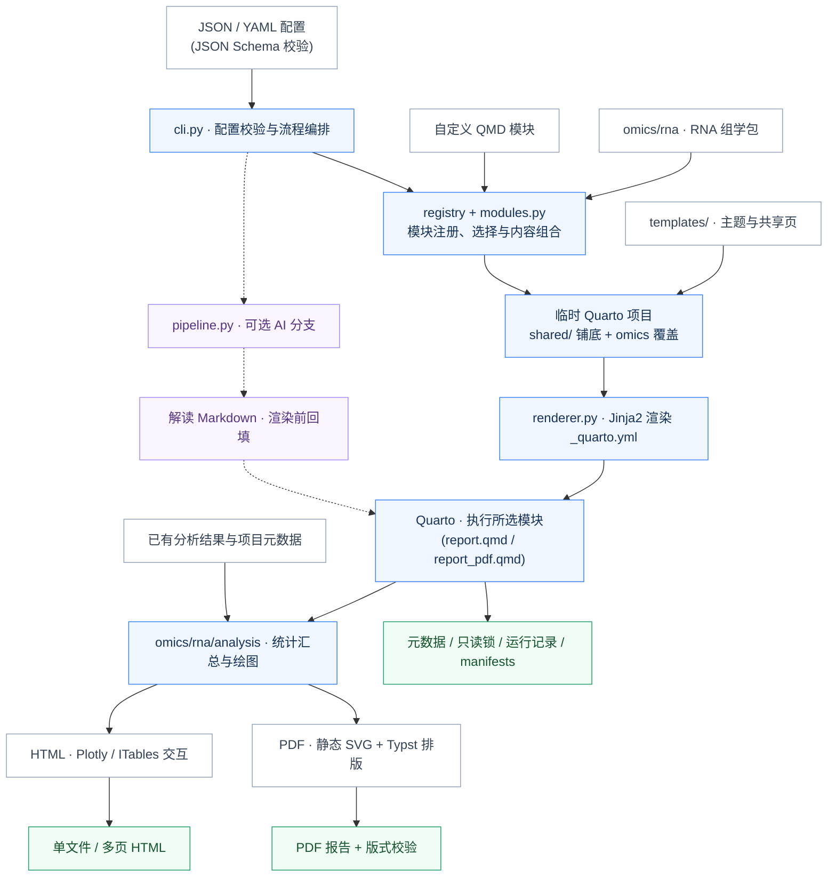

# BioReport 架构详解

> 版本:v1.0(2026-10-17)
> 定位:本文档描述**当前代码实现**的架构与数据流,是 [README](../README.md)「技术架构」一节的展开版;README 面向使用者,本文档面向维护者与贡献者。两者保持链接互通,若本文与代码冲突,以代码为准并优先修正本文。

## 1. 设计原则

**配置决定结构,模块承载内容;分析函数复用,交付形式适配。**

- **引擎组学无关**:`bioreport/` 核心引擎不引用任何具体组学;组学内容以插件包形式放在 `omics/<x>/`。
- **双层模板**:`templates/` 提供所有组学共用的壳(主题、共享页、PDF Typst 样式);`omics/<x>/qmd/` 提供组学专属页面;构建时在临时目录中叠加合并。
- **一份数据,两种交付**:HTML 与 PDF 共用同一套分析函数(`omics/rna/analysis/`),仅在展示层分叉(Plotly 交互图 vs 静态 SVG)。
- **全流程可溯源**:输入 SHA256、provenance、交付 manifests、SQLite 运行记录贯穿每次运行。

## 2. 系统全景



> 架构图源文件唯一维护于 `templates/shared/assets/architecture.mmd`(README 中有一份同步副本),此处不再重复维护图源,改动架构请以该文件为准。

## 3. 目录结构(真实清单)

```text
.
├── bioreport/                   # 组学无关核心引擎与 CLI
│   ├── __main__.py / cli.py     # python -m 入口;CLI 解析与主流程编排
│   ├── config.py                # YAML/JSON 统一配置加载、旧格式归一化、Schema 校验
│   ├── report.schema.json       # 报告配置字段与取值约束(Draft202012Validator)
│   ├── registry.py              # 模块注册表(Module 契约、别名、默认模块)
│   ├── modules.py               # 内置共享模块、模块选择校验、内容组合(HTML/PDF/website)
│   ├── renderer.py              # Jinja2 渲染 _quarto.yml、字体 staging
│   ├── pipeline.py              # AI 分析流程封装(触发条件 + 两步调用)
│   ├── assets/                  # 内置字体(PDF 与离线 HTML 使用)
│   ├── ai/                      # AI 调用引擎
│   │   ├── engine.py            #   volcengine(Ark SDK)/ aliyun(OpenAI 兼容)、降级、限长、计价
│   │   └── schemas.py
│   ├── report/                  # PDF 语义文档模型与渲染后校验
│   │   ├── model.py             #   语义块词汇表(Section/TableBlock/FigureBlock/…)
│   │   ├── planner.py           #   毫米级布局高度估算与跨页策略
│   │   ├── composition.py       #   章节组合,序列化为 report-plan.json
│   │   ├── recording.py         #   QMD 执行期语义块记录(jsonl)
│   │   ├── validation.py        #   PDF 版式/内容校验(layout query、墨水占比、书签)
│   │   └── content_validation.py#   渲染结果与原始输入逐字段比对
│   └── utils/
│       ├── consolidate_rna_seq_data.py  # AI 数据整合与报告生成
│       ├── render_output.py / print_theme.py / pdf_results.py  # 格式感知展示与静态图导出
│       ├── fonts.py / font_stage.py     # 字体发现与 staging
│       ├── pdf_metadata.py / pdf_security.py  # PDF 元数据与 AES-256 只读锁
│       ├── provenance.py        # 溯源信息、交付 manifests 及重哈希校验
│       ├── run_db.py            # SQLite 运行记录(~/.bioreport/runs.db)
│       ├── report_utils.py / visualize_utils.py / setup_report.py
│       └── prompt.txt           # AI 默认 Prompt
├── omics/                       # 组学插件包(自动发现)
│   ├── __init__.py              # load_all():遍历子包调用 register(registry)
│   ├── base.py                  # OmicsPackage Protocol
│   └── rna/                     # RNA-seq 模块
│       ├── modules.py           # 13 个模块声明、输入契约、导航图标、短别名
│       ├── schema.json          # RNA 分析参数 schema(当前仅文档/计划用途)
│       ├── qmd/                 # RNA 页面(index/workflow/qc/results + pdf/ 专用变体 + modules/)
│       └── analysis/            # HTML/PDF 共用的数据处理与绘图函数
├── templates/                   # 引擎级共享模板与资源
│   ├── _quarto.yml.j2           # website 布局 Quarto 配置
│   ├── _quarto-single.yml.j2    # single 布局配置(embed-resources)
│   ├── shared/                  # 共用内置页(about/faq/license/trademark/AI)+ 架构图资产
│   ├── theme/                   # HTML 主题(New_Brutalism.scss、styles.css 等)
│   ├── pdf/                     # PDF Typst 样式(layout.lua、print-*.typ、rna-cover.typ.j2)
│   ├── reference/               # bibliography / csl 引用资源
│   └── logo/
├── configs/                     # 示例配置(report.example.json / report.generic.json)
├── examples/                    # RNA 与通用 assay 示例数据
├── tests/                       # 16 个 test_*.py + golden/ + 渲染支撑脚本
├── archive/                     # 旧版归档,不参与运行
├── deploy/Dockerfile            # 唯一 Docker 交付定义
└── docs/Architecture.md         # 本文档
```

## 4. 核心引擎 `bioreport/`

### 4.1 CLI 与主流程(`cli.py`)

只有三个子命令(`cli.py:63`):`run`(默认,完整生成)、`validate`(仅 Schema 校验)、`init`(只打印提示,不生成文件)。

`run` 的流水线顺序(每一步都可对照 `cli.py:442-542` 验证):

1. **配置加载**:`load_config()` 按后缀识别 `.yaml/.yml/.json`,旧 `project_meta` 结构自动归一化为 `project`,Draft202012Validator 按 `report.schema.json` 校验(`config.py:96-220`)。
2. **模块与格式选择**:`selected_modules()` 解析 `report.modules`(含别名链)、父子模块互斥、website 布局限制;`output_format` 支持 `html`、`pdf` 或两者。
3. **模板合并 staging**(`cli.py:474-493`):临时目录中先拷贝 `templates/`,再把 `templates/shared/` 铺为 `qmd/` 根,最后以 `dirs_exist_ok=True` 叠加 `omics/rna/qmd/` —— **同名文件组学页优先**。
4. **溯源写入**:输入文件 SHA256、模块清单、引擎版本写入 `qmd/provenance.json`。
5. **输入检查**:按 registry `required_inputs` 检查必需输入,Rich 表格展示缺失项。
6. **Jinja2 渲染**(`renderer.py`):生成 `_quarto.yml`;single 布局按需组合 `qmd/report.qmd` / `qmd/report_pdf.qmd`。
7. **AI 管线**(可选,见 §7)。
8. **Quarto 渲染**(`render_report`,`cli.py:345-410`):注入 `REPORT_CONFIG`、`TYPST_FONT_PATHS` 等环境变量,`quarto render` 按格式执行;PDF 渲染后依次做元数据写入、版式/内容校验、只读锁。
9. **收尾**:SQLite 运行记录、配置备份(`run_config_backup.json`)、四个交付 manifests 及全量重哈希校验。

> `--dry-run` 在输入文件检查**之后**返回:它会真实检查输入文件(缺失必需输入照样报错),只跳过 AI 与 Quarto 渲染。

### 4.2 配置层(`config.py` + `report.schema.json`)

- `load_config()` 统一入口;`data_dir` 为相对输入路径的根;`project.project_id` 必填并用于输出文件命名(`<project_id>_report.<格式>`)。
- 向后兼容:旧 YAML、`project_summary.json` 归一化(`config.py:62-93`);默认配置搜索路径含容器内 `/app/project_summary.json`。
- 日志命名:`<project_id>_<YYYYMMDD-HHMMSS>_bioreport.log`。

### 4.3 模块注册与组合(`registry.py` + `modules.py`)

- 契约:`Module` dataclass(id、qmd、title、category、required_inputs、default_params、parent、setup_qmd、icon 等,`registry.py:7-19`)。
- 全局单例 registry 首次使用时 `from omics import load_all` 自动装载全部组学包(`registry.py:84-91`)。
- 内置共享模块不走 registry,硬编码于 `modules.py:16-23`:`ai/about/faq/license/trademark/provenance`(QMD 来自 `templates/shared/`)。
- RNA 模块(`omics/rna/modules.py`):13 个 ID(`rna.index`、`rna.qc.fastp/.screen/.qualimap/.star`、`rna.results.samples/.matrix/.heatmap/.deg/.enrichment` 等),短别名 `qc.fastp` 等映射到 `rna.*`;默认模块 `rna.index/workflow/qc/results`。
- 组合(`compose_report`,`modules.py:247-512`):子模块前插父模块 setup 单元;`#| label:` 与 `@ref` 按模块命名空间化(同一 QMD 可用不同 ID/params 重复引用);相对 include 递归展开(防目录逃逸、防循环);bibliography/csl 自动 staging。

### 4.4 PDF 语义模型与校验(`report/` 子包)

PDF 独有的"先规划、再渲染、后校验"三层:

- `model.py` 定义语义块词汇(Section、MetricGrid、TableBlock、FigureBlock、CalloutBlock、MethodBlock 等,带 keep_together / preferred_height)。
- `composition.py` 把模块正文包成 Section,经 `planner.py` 毫米级高度估算后序列化为 `report-plan.json`。
- QMD 执行期 `recording.py` 把每个语义块追加到 jsonl;渲染后 `validation.py` 用 Typst layout query + pypdfium2(墨水占比、空白页、书签/目录页码)校验版式,`content_validation.py` 将渲染结果与**重新读取的原始输入**逐字段比对(样本数、DEG 上下调数、SHA256 等)。

## 5. 组学插件层 `omics/`

- **自动发现**:`omics/__init__.py:7-14` 用 `pkgutil.iter_modules` 遍历子包并调用其 `register(registry)`;`base.py` 定义 `OmicsPackage` Protocol。新增组学的模块注册是零改动的。
- **RNA 包**(`omics/rna/`):`modules.py` 声明模块与输入契约;`qmd/` 为页面模板(`pdf/` 子目录是 PDF 专用变体,如 Executive Summary);`analysis/` 是 HTML/PDF 共用的 pandas/Plotly 绘图函数(PCA、热图、富集、QC 可视化)。
- **已知硬编码缺口**(新增组学时需注意):
  1. QMD staging 目前硬编码 `omics/rna/qmd` 候选路径(`cli.py:482-488`),新组学页面要进临时项目还需改这里;
  2. PDF 封面、workflow 图替换等逻辑以 `has_rna` 分支特判(`modules.py:264,288,325`);
  3. `pyproject.toml` 需为新包加 package-data 声明。

## 6. 模板层 `templates/` 与合并机制

| 目录 | 内容 | 消费方 |
| :--- | :--- | :--- |
| `_quarto*.y2` | Quarto 配置 Jinja2 骨架 | `renderer.py` |
| `shared/` | 共用内置页 + 架构图资产 | 铺为临时 `qmd/` 根(`cli.py:480`) |
| `theme/` | HTML 主题与 CSS | single/website HTML |
| `pdf/` | Typst 样式、`layout.lua`、打印上下文、RNA 封面模板 | PDF 路径(`modules.py:265-324`) |
| `reference/` | bibliography / csl | 模块组合时 staging |
| `logo/` | 报告 Logo | HTML navbar / PDF 封面 |

合并规则:`templates/shared/` 是底座,`omics/<x>/qmd/` 覆盖叠加 —— 因此只有 `rna.*` 注册模块和 `qmd/pdf/` 下的内容是 RNA 专属,其余对所有报告类型生效。

## 7. AI 管线(`pipeline.py` + `ai/engine.py`)

触发条件:`"ai"` 在 `report.modules` 中且 `ai.enabled` 为 true(`cli.py:524-525`)。

1. **数据整合**(`utils/consolidate_rna_seq_data.py`):按配置引用顺序读取 DEG/富集文件,受 `deg_limit`(默认 20)、`enrichment_limit`(默认 10)限制,产出 `data/consolidated_rna_seq_data.txt`;支持自定义 `prompt_file`。
2. **模型解读**(`ai/engine.py`):`volcengine` 走 Ark SDK + `ARK_API_KEY`(默认模型 `doubao-seed-1-6-251015`);`aliyun` 走 OpenAI 兼容接口 + `DASHSCOPE_API_KEY`(**必须显式指定模型**),`base_url` 可配。内置 tenacity 重试、`fallback_providers` 自动降级、`max_input_tokens` 截断与 `pricing` 成本估算。
3. **渲染前回填**:解读结果写为 `data/consolidated_rna_seq_report.md`,`templates/shared/AI.qmd` 以 include 嵌入 —— 即在 Quarto 渲染前就绪。

模型生成内容需研究人员审阅;AI 是可选分支,不启用时完全不依赖 AI 依赖与 API Key。

## 8. HTML 与 PDF 两条交付路径

同一 `compose_report()` 按 `pdf` / `website` 标志分叉:

| | single HTML(默认) | website HTML | PDF |
| :--- | :--- | :--- | :--- |
| 入口 | `qmd/report.qmd` | 每章 `qmd/site-*.qmd` | `qmd/report_pdf.qmd` |
| 资源 | `embed-resources: true` 单文件 | 多页、外链资源 | A4 Typst 排版、独立封面+目录 |
| 图表 | Plotly 交互 + ITables | 同左 | Plotly trace 坐标导出静态 SVG(不重算统计) |
| 页面 | 顶部 navbar 切换章节 | Quarto 侧边导航 | 语义块规划 + 版式校验 |
| 专属逻辑 | 两个 Logo 链接、字体 @font-face staging | 强制 index 模块、禁用子模块 | RNA 封面、Executive Summary、方法附录、只读锁 |

## 9. 溯源与运行记录

- **provenance**:输入 SHA256、引擎版本、模块清单写入 `qmd/provenance.json`,供共享页/组学页/页脚在 Quarto 阶段读取。
- **运行记录**:SQLite(`~/.bioreport/runs.db`,`BIOREPORT_DB` 可覆盖)记录每次运行的项目、配置、输出目录与 success/failed 状态;失败只告警不阻断。
- **交付 manifests**(`utils/provenance.py`):`report-manifest.json`、`input-manifest.json`、`artifact-manifest.json`、`reproduction-manifest.json`(+`reproduction-config.json`),写完后全量重哈希校验,失败即报错。

## 10. 扩展指南

### 10.1 新增自定义模块(无需改代码)

在配置中声明 `report.module_definitions`:映射模块 ID → QMD 路径(相对配置文件目录)、标题、`params`、必需输入;QMD 内通过 `REPORT_CONFIG` / `report_module["params"]` 读取配置,用 `show_table()` / `show_figure()` 输出格式感知结果。示例见 `examples/generic-assay/`。

### 10.2 新增组学包(需少量引擎改动)

1. 新建 `omics/<x>/`:实现 `register(registry)` 声明模块与输入契约,提供 `qmd/` 页面与 `analysis/` 函数;
2. 修改 `cli.py:482-488` 的 staging 候选路径,纳入新组的 `qmd/`;
3. 如需要 PDF 封面/专属排版,在 `modules.py` 仿照 `has_rna` 增加分支;
4. `pyproject.toml` 增加 package-data。

### 10.3 修改共享页面 / 主题

- 共用页面(about/faq/license/trademark/AI/provenance):`templates/shared/`,影响所有报告类型。
- HTML 主题:`templates/theme/`;PDF 样式:`templates/pdf/`;RNA 页面:`omics/rna/qmd/`。

## 11. 验证与测试

- `bioreport validate -c <配置>`:仅 Schema 校验。
- `bioreport run --dry-run`:模块选择 + 模板组合 + **输入文件检查**,跳过 AI/Quarto。
- 常规测试:`pip install -e '.[rna,dev]' && python -m pytest -q tests -k "not integration"`。
- 完整渲染集成测试(需 Jupyter 内核与 Kaleido):`RUN_REPORT_INTEGRATION=1 python -m pytest -q tests/test_integration_render.py`。

## 相关文档

- [README](../README.md) — 项目简介、快速上手、配置字段手册
- [PDF 样式规范](pdf-style.md) — 共享样式约定与验证命令
- [仓库重构方案](bioreport-repo-refactor-plan.md) — 现状从何而来(历史设计依据)
