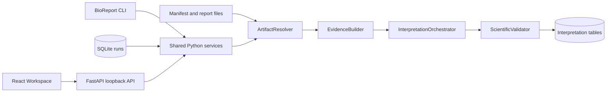
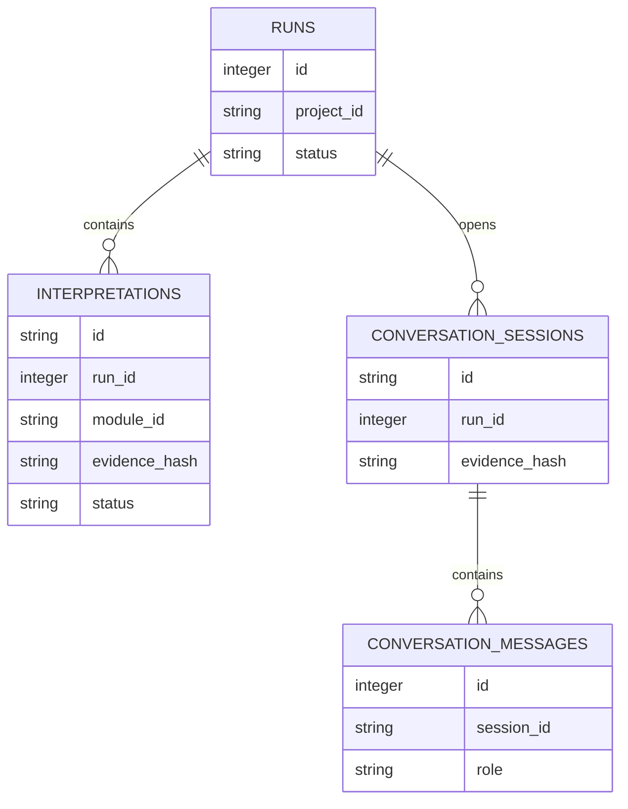
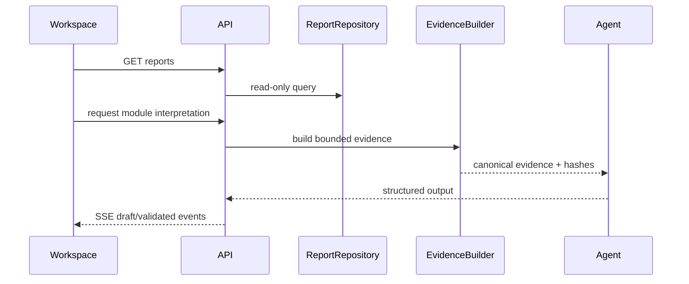

# BioReport Workspace v1 architecture

The database stores identity, status, hashes, and versioned interpretation metadata. Large report content remains in trusted filesystem roots and is accessed by logical artifact IDs.
