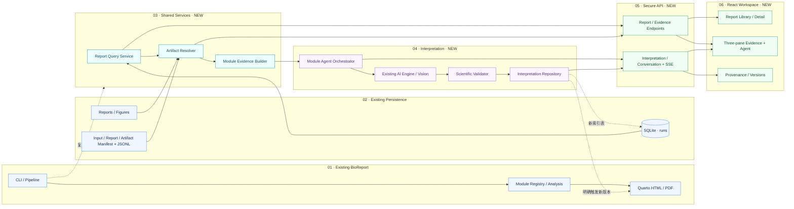
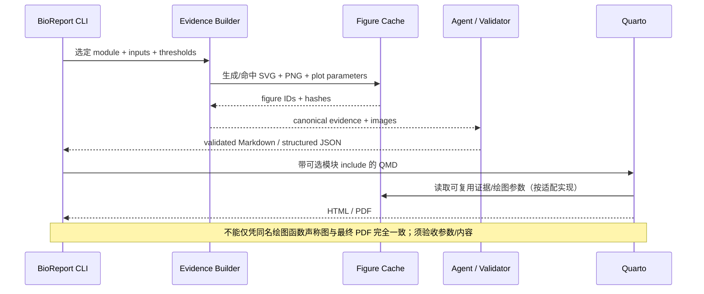
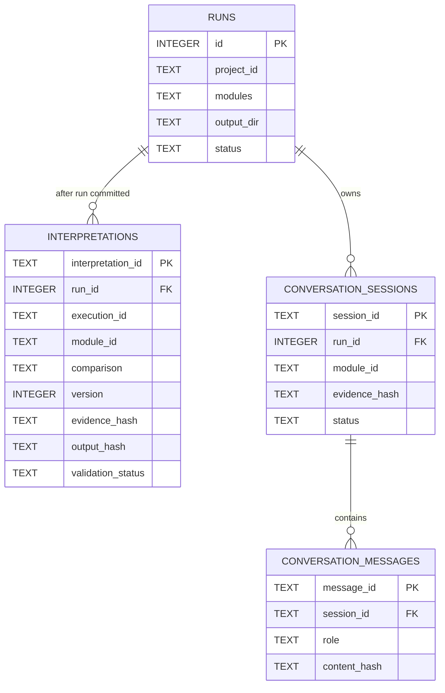
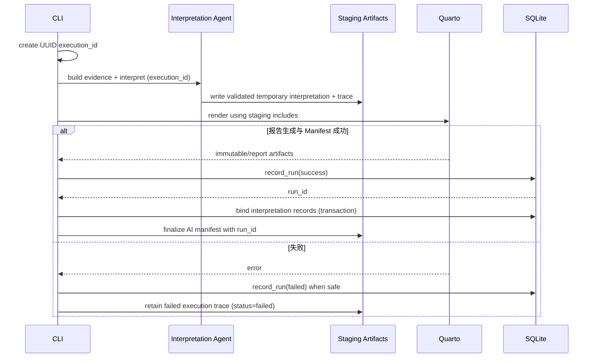

# BioReport × Interpretation Agent × AI Workspace v1.0
## 全栈一体化详细实施设计与验收规范

> **版本** v1.0 · **日期** 2026-10-17 · **状态** 已完成当前工作区可实现项；真实浏览器、LLM、Quarto 内核与生产身份集成仍按门禁标记  
> **配套执行文件** [`BioReport_Workspace_v1_Codex_Master_Prompt.md`](./BioReport_Workspace_v1_Codex_Master_Prompt.md)  
> **目标** 一次性建立历史报告浏览、证据检索、图文 AI 科学解读、交互问答、版本溯源、HTML/PDF 原位回填、Web 工作台与 CygnusX 可调用 API 的**完整可运行 v1.0**。  
> **重要澄清** 本文同时保留设计约束与当前实施核对结果；实现证据以仓库源码、测试命令和 [`bioreport-workspace-v1-runtime-acceptance.md`](../../architecture/bioreport-workspace-v1-runtime-acceptance.md) 为准。Mock 通过不等于真实 LLM、Quarto 或浏览器 E2E 通过。

---

## 0. 信息来源、当前事实与设计假设

### 0.1 审计来源

1. 用户提供的 `bioreport-database-persistence-architecture-audit.md`（2026-10-17，静态审计 + SQLite `mode=ro` 检查）。
2. 用户提供的《BioReport Interpretation Agent 可行性审计报告》（2026-10-17，当前 AI 路径、Quarto 绘图与 Registry 静态审计）。
3. 参考前端：[Treasure-Seeking_Mouse](https://github.com/xsx123123/Treasure-Seeking_Mouse)、[frontend-style-spec.md](https://github.com/xsx123123/Treasure-Seeking_Mouse/blob/main/docs/ARC/frontend-style-spec.md)、[package.json](https://github.com/xsx123123/Treasure-Seeking_Mouse/blob/main/package.json)。当前 README 显示 React/Vite、SSE 等交互方式；实际复用必须以当时可访问的源码和许可证为准。
4. BioReport 当前仓库为实施时最高优先级事实来源，以上审计为历史快照，不得以其替代现场检查。

### 0.2 历史审计基线（不代表当时已实现本设计）

| 主题 | 审计时已确认 | 目标设计影响 |
|---|---|---|
| SQLite | `bioreport/utils/run_db.py` 使用原生 `sqlite3`，数据库默认 `~/.bioreport/runs.db`，可用 `BIOREPORT_DB` 覆盖 | 复用而非重建 ORM |
| Schema | 仅 `runs` 业务表，无外键/业务索引/迁移版本；`runs.id` 为自增运行记录 ID | 先建可回滚迁移，再新增解读/会话表 |
| 历史快照 | 49 条运行（48 success/1 failed），10 条 `output_dir` 当时不可达 | 必须保留记录并展示不可用状态；记录数不作为固定指标 |
| 持久化 | `runs` 保存运行摘要；HTML/PDF/SVG/Manifest/JSONL 放在文件系统 | 数据库索引 + Artifact Resolver + Manifest |
| 运行时序 | Quarto/Manifest 完成后才写 `record_run(success)`，失败记录也在特定结束路径上产生 | 预渲染 Agent 必须先使用 `execution_id`，最后绑定 `run_id` |
| 模块 | Registry 有 `rna.qc.fastp/screen/qualimap/star`、`rna.results.samples/matrix/heatmap/deg/enrichment` 等真实标识 | 子模块为解读单元；`matrix` 不发送全矩阵 |
| 现有 AI | 全局文本整合、Quarto 前执行、`AI.qmd` 集中 include；未消费 Registry；活动路径不传图片/tool calls | 新增逐模块 Evidence & 可选原位插槽 |
| 绘图 | draw/plot 函数可脱离 Quarto 复用，PDF SVG 在运行期输出，HTML/PDF QMD 分支不同 | 提前证据图缓存，必须测图/参数一致性 |
| Engine | fallback/token/pricing 代码存在，但活动 CLI 调用未传全部配置（此前审计） | 优先修复配置链路并测试各 Provider |
| Web | 尚无成熟 FastAPI/Report Repository/账户 API | 服务层与前端均为拟新增 |

**未知事项**：实际数据库现在是否扩容、不同输出目录规则、Manifest 每个字段版本、Ark SDK 真实能力、Quarto/浏览器/真实模型环境、CygnusX 鉴权集成权限。它们只能在现场核验后标记 PASS。

### 0.3 产品完成定义

**不是**“有一个图形界面”和“一次 LLM 接口”。完成意味着：

`历史 runs -> 报告详情 -> 可信产物 -> 模块证据 -> 可验证图文解读 -> 保存版本 -> 会话追问 -> 可选原位回填 -> HTML/PDF -> 审计关联`。

必须同时保持旧 CLI 在 AI 关闭、数据库缺失/只读、无 Key、旧配置时的兼容行为。

---

## 1. 架构边界与横向总图



**调用契约**：CLI 可直接调用 Python Service，无须启动 API；React 和 CygnusX BioOps 只能通过授权 API；文件系统不能直接暴露给浏览器。**职责边界**：统计计算确定性；LLM 仅解释，不执行任意代码、不覆盖正式交付物；文件写入/版本入库由确定性代码完成。

### 1.1 两种使用场景

- **自动报告场景**：CLI 选模块 -> 本地构建 Evidence -> AI 解释并核验 -> QMD 插槽 -> Quarto -> 新 HTML/PDF 和 Manifest -> 正式 run/interpretation 关联。
- **历史工作台场景**：用户选择 `run_id` -> 读取 SQLite + Artifact Manifest -> 获取能复用的 Evidence/图像 -> 单模块问答/解读 -> 生成独立新 interpretation version；旧 HTML/PDF 默认完全不变。

### 1.2 不能混淆的实体

| 术语 | 身份/生命周期 | 是否当前存在 |
|---|---|---|
| `project_id` | 一组研究/分析业务项目，不等于一次运行 | 已有 |
| `run_id` | 本地 SQLite `runs.id`，仅在当前 DB 中唯一 | 已有 |
| `execution_id` | 一次报告执行前就能产生的唯一 ID，建议 UUID | 已实现：Workspace schema v2 启用后由 CLI 在 AI/Quarto 前创建，并在 `runs.id` 写入后绑定；旧库不隐式迁移 |
| `artifact_id` | 服务端已登记产物逻辑标识，不是任意文件路径 | 已实现：`ArtifactResolver` 只解析 Manifest 登记的逻辑 ID，并隐藏本地路径 |
| `module_id` | Registry 标识（如 `rna.results.deg`） | 已有 |
| `evidence_hash` | 一次规范化证据内容的身份指纹 | 已实现：Evidence Builder 对规范化证据包计算 SHA-256，并持久化到 interpretation/session |
| `interpretation_id` | 一次 AI 解读版本 ID（与 run/module/比较组绑定） | 已实现：SQLite `interpretations.id`，版本按 run/module/comparison 递增 |
| `conversation_id` | 基于指定 run/module/evidence 快照的交互会话 | 已实现：SQLite `conversation_sessions.id` 与独立消息表 |

---

## 2. 可实施的代码组织（建议而非强制固定）

```text
bioreport/
  utils/run_db.py                 # REUSE；兼容旧查询和写入
  report_service.py               # NEW；RunQueryService / ReportDetail
  artifacts.py                    # NEW；ArtifactResolver / ManifestReader / BlockReader
  report_dto.py                   # OPTIONAL；统一 DTO（如现有 models 更合适可合并）
  ai/
    engine.py                     # REUSE/FIX；配置、多模态、provider 降级
    evidence.py                   # NEW；Module Evidence Builder
    interpreter.py                # NEW；Agent Orchestrator / Prompt Registry
    validator.py                  # NEW；科学核验与输出结构
    tools.py                      # OPTIONAL；按需受控工具
    persistence.py                # NEW；Interpretation Repository
    prompts/base.md               # NEW
    prompts/rna/*.md              # NEW
  api/                             # NEW；FastAPI 路由/依赖/鉴权/DTO/SSE
    app.py
    routes_reports.py
    routes_interpretation.py
    routes_conversation.py
    auth.py
  db/                              # NEW；非破坏性 schema migrations
    migrations/
  ... existing registry, pipeline, qmd, provenance ...
frontend/                          # NEW；独立 Web build；名称以现有仓库习惯为准
  src/
    app/
    routes/
    components/report/
    components/agent/
    components/evidence/
    services/api.ts
    services/sse.ts
    styles.css
    i18n/
tests/
  test_report_service.py
  test_artifact_security.py
  test_evidence_deg.py
  test_interpretation_validator.py
  test_interpretation_persistence.py
  test_api_auth.py
  test_sse_contract.py
  test_quarto_interpretation.py
  fixtures/report_workspace/
```

新增组件优先**逻辑分层，避免过度拆文件**；如果仓库已有等价命名，允许复用并在实施记录给出映射。避免引入异构第二后端或两套 Report Repository。

---

## 3. 阶段 Phase 0：基线审计与冻结接口

### 3.1 必须先检查

- `git status --short`，已有修改不覆盖、不自行提交。
- `bioreport/utils/run_db.py`、`bioreport/cli.py`、`bioreport/pipeline.py`、`bioreport/ai/engine.py`。
- `bioreport/utils/provenance.py`、`bioreport/report/{model,recording}.py`、`bioreport/registry.py`、`omics/rna/modules.py`。
- HTML/PDF QMD 两套路径、SVG exporter、现有测试、真实 Manifest fixture 及 Quarto 环境。
- Treasure-Seeking_Mouse `AGENTS.md` 与前端规范，审查其许可证和拟借鉴组件（只读）。

### 3.2 基线输出

`docs/architecture/bioreport-workspace-v1-baseline.md` 至少包含：源码 Commit、现有文件清单、运行数据库读/写路径、Manifest 真实字段、模板差异、已通过的测试、尚不可验证的运行环境。对下文所有建议 DTO/Schema 如有偏差，应优先与真实源码兼容，并记录差异。

### 3.3 通过条件

数据流和身份边界无未解决冲突；所有新增依赖用途明确；用户生产数据库/输出目录未写入；可开展安全查询实现。

---

## 4. 阶段 Phase 1：Report Query / Artifact / Module Service

### 4.1 保留 `runs` 原表

已审计表（以代码为准）：

```sql
CREATE TABLE IF NOT EXISTS runs (
  id INTEGER PRIMARY KEY AUTOINCREMENT,
  project_id TEXT NOT NULL,
  run_at TEXT NOT NULL,
  engine_version TEXT,
  pipeline_version TEXT,
  layout TEXT,
  output_format TEXT,
  modules TEXT,
  config_path TEXT,
  output_dir TEXT,
  status TEXT NOT NULL,
  input_checksums TEXT,
  created_at TEXT NOT NULL
);
```

不直接对用户真实库执行迁移或写入测试。旧 `fetch_runs/search_runs/record_run` 公共行为保持兼容。新增查询采用 `mode=ro` + `PRAGMA query_only=ON`、参数绑定、分页（`id DESC + cursor` 优先）、限定 `limit <= 100`，数据库缺失返回 `DATABASE_UNAVAILABLE` 而非自动创建。

时间筛选如库内混合时区字符串，需用已定义的规范化策略，不假设直接字符串比较总是正确。未知历史 `module_id` 原值保留并标注 `UNKNOWN_MODULE`，不删除。

### 4.2 Report DTO 典型实例（**示例非当前真实记录**）

```json
{
  "run_id": 49,
  "project_id": "PRJ-RNA-PDF-001",
  "run_at": "2026-10-17T11:58:27+08:00",
  "status": "success",
  "output_formats": ["pdf"],
  "modules": [{"module_id": "rna.results.deg", "registry_status": "REGISTERED"}],
  "artifact_availability": "PARTIAL",
  "manifest_status": "UNVERIFIED",
  "warnings": []
}
```

区分 `RunSummaryDTO`（用于列表，不批量读所有大 Manifest）、`ReportDetailDTO`（细节、可用性）、`InternalRunRecord`（允许带敏感原始本地路径，仅后端内部）。输出不能包含 API Keys、完整配置、任意系统路径。

### 4.3 Artifact Resolver 严格安全条件

入参为 `(run_id, artifact_id)`，不是 `path`；产物来自 Manifest 服务端解析或白名单固定逻辑标识。具体解析流程：

1. 通过 `runs.output_dir` 取得候选目录，按**服务端可信根目录白名单**判断；默认不能随意把 `output_dir` 中任意绝对路径当作可信。
2. 规范化路径组件并阻止 `..`、symlink 逃逸、非普通文件和目录冒充；预备阶段可用 `Path.resolve(strict=True)`/`relative_to`，正式文件读取需考虑 TOCTOU，支持平台时使用安全的目录 FD/openat/no-follow 策略。
3. Manifest 路径也是不可信输入，不能拼接后直接读取；限制 Manifest 大小、JSON 解析深度与记录数。
4. 只对登记的文件做存在性、MIME/后缀合理性、size、SHA256 验证；sha256 流式计算；`UNVERIFIED` ≠ `MATCH`。
5. 对于 `output_dir` 失效返回 `PATH_UNAVAILABLE`，保留 `runs` 记录；未登记/越界返回明确拒绝，不可被历史回退逻辑放行。
6. HTML 报告可能含脚本/交互代码；浏览器预览优先沙箱 iframe、专属源或防越权受控 URL，配置严格 CSP 与 sandbox，不能以主应用权限执行不可信脚本。PDF 也要受控响应头与内容下载策略。
7. 避免 API 把绝对路径、用户目录、文件系统错误栈泄露给客户端。

推荐分离两轴状态：

```text
availability: AVAILABLE | ARTIFACT_MISSING | PATH_UNAVAILABLE | PATH_FORBIDDEN | MANIFEST_MISSING | MANIFEST_INVALID | PERMISSION_DENIED
integrity: MATCH | MISMATCH | UNVERIFIED | CHECK_ERROR
```

### 4.4 模块/语义块证据

- 从 `runs.modules` JSON 获取当前运行选择的模块；当前 Registry 可解释标题/父子关系，但不能伪造已完成的模块执行状态。
- 读取现有 `report-blocks-*.jsonl`，保持 `FigureBlock.id / TableBlock.id`；JSONL 遇坏行做结构化诊断。
- HTML 尚缺 PDF 同等级别 block manifest 保证，未记录不表示图表不存在；需预留 `UNRESOLVED`。
- 不可仅凭 PDF 页码/图标题将图表绑定模块；Evidence Builder 将来建立 `figure_id -> module_id/analysis parameters/source hash` 显式关联。
- 不能凭只有 PDF 的历史记录推断可恢复结构化 DEG/TPM；输入不存在时返回 `EVIDENCE_SOURCE_MISSING`，显示仍可阅读 PDF。

### 4.5 本阶段验收

临时 SQLite fixture 通过 run filter/cursor/坏 JSON/未知模块/丢失目录/错 Hash；路径穿越、绝对路径、符号链接/恶意 Manifest 全拒绝；现有 CLI 运行与查询回归无破坏；真实历史库只读抽样只读检查不更改数据。

---

## 5. 阶段 Phase 2：Module Evidence Builder 与 Agent Core

### 5.1 Evidence Package v1

规范化结果由确定性 Python 生成。示例（值仅示意，实装按当前报告数据与阈值计算）：

```json
{
  "schema_version": "1.0",
  "project_id": "PRJ-RNA-PDF-001",
  "run_id": 49,
  "execution_id": null,
  "module_id": "rna.results.deg",
  "comparison": "2_vs_1",
  "metadata": {"species": "Mus musculus", "reference_genome": "GRCm39"},
  "statistics": {
    "up": 4364,
    "down": 2705,
    "thresholds": {"pvalue_type": "raw", "pvalue_lt": 0.05, "abs_log2fc_gt": 1.0}
  },
  "tables": [{"source_id": "deg_2_vs_1", "columns": ["Symbol", "log2FoldChange", "pvalue", "padj"], "row_limit": 10}],
  "figures": [{"figure_id": "volcano_2_vs_1", "artifact_id": "figure_deg_001", "sha256": "<sha256>"}],
  "source_artifacts": [{"source_id": "deg_2_vs_1", "sha256": "<sha256>"}],
  "evidence_hash": "<canonical-json-hash>",
  "warnings": []
}
```

数值的示例取自用户此前提供的 RNA-seq PDF，**仅用来解释 Schema，严禁硬编码**。同一模块不同 `comparison` 必须各自建立包、缓存和解读；富集的 UP/DOWN 可一次联合解读，但必须保留两组原始统计证据。

### 5.2 RNA 模块与调用预算

| 模块 | 建议 Evidence | AI 调用粒度 | 限制 |
|---|---|---|---|
| `rna.qc.fastp` | 统计表 + 过滤/质量曲线 | 每模块一次 | 不仅凭重复率判失败 |
| `rna.qc.screen` | R1/R2 分布 + 统计 | 联合一次 | 非目标物种特异匹配谨慎解释 |
| `rna.qc.qualimap`、`rna.qc.star` | coverage + mapping QC | 可合并一次 | 合并只是产品调度策略，保留原 module_id 证据 |
| `rna.results.samples` | PCA、表达分布、解释率、样本元信息 | 两图联合一次 | 无统计检验不写“显著差异” |
| `rna.results.heatmap` | HVG 图、聚类参数 | 一次 | 不发送全 TPM 矩阵 |
| `rna.results.deg` | 火山图、计数、阈值、Top DEG | 每 comparison 一次 | raw P 与 padj 不混淆 |
| `rna.results.enrichment` | UP/DOWN GO/KEGG 图与表 | 每 comparison 一次 | 不能推断因果关系 |
| `rna.results.matrix` | 仅只读预览 | 默认零次 | 禁止发送全矩阵 |

### 5.3 单 Agent 形态与工具策略

- `InterpretationOrchestrator` 首先从 Evidence Builder 获得已准备的 schema + PNG，多模态直接一次模型调用；这是默认路径（可能 **0 个自主工具调用**）。
- 如需要更深问题，最多启用候选三工具：`get_module_evidence(module_id)`、`read_result_table(source_id, columns, filters, limit)`、`get_figure(figure_id)`；严格使用逻辑 ID、白名单、限制返回大小、超时、轮数上限 2–3。`get_figure` 返回登记元数据/图像句柄，由服务端将图片作为 multimodal content part 传给视觉模型，而非把 base64 填在普通文本字段。
- 不暴露 `write_file(path)`、任意 shell/python、网络抓取、完整表达矩阵；`write_section` 应为编排器的内部确定性函数，而非模型工具。
- 完全使用现有 `AIInterpreter`/Provider 能力为基础；修复 CLI -> AI Engine 的完整配置传递，并为视觉模型能力检测/非视觉自动剥离图片/纯文本摘要降级添加测试。

### 5.4 图表一致性与渲染时序



旧 Quarto 图形函数是否允许直接复用缓存文件要通过真实代码核验。第一版可以共用同一数据和绘图参数并导出 PNG/SVG，再用图形参数 hash 与图表产物比对；如 PDF 仍重新绘图必须记录一致性测试策略。避免“Agent 看 A 图、用户看 B 图”。

### 5.5 科学输出 Schema 与验证

建议模型先返回**结构化 JSON**，由系统生成 Markdown；包含：

```json
{
  "module_id": "rna.results.deg",
  "comparison": "2_vs_1",
  "observations": [{"text": "...", "evidence_refs": ["source:deg_2_vs_1"]}],
  "interpretations": [{"text": "...", "evidence_refs": ["figure:volcano_2_vs_1"], "confidence": "limited"}],
  "hypotheses": [{"text": "...", "requires_validation": true}],
  "limitations": ["..."],
  "summary": "..."
}
```

Validator 必须校验：ID/比较组吻合、证据引用存在、数字与阈值一致、`pvalue` 与 `padj` 不替换、缺失标注、跨模块/跨项目证据禁止串用、Markdown/HTML 安全清洗、误导性机制归因识别。不能通过机器规则证明全部生物学因果正确；至少做到事实一致、来源可追踪、输出不合格不成为正式解读。记录验证失败原因。

**模型隐私**：即使不上传全矩阵，PNG 图和 Top DEG/项目元数据也可能具有保密性；必须有项目级 LLM 发送授权/明确配置开关、发送字段最小化、API Key 服务器保管、不输出原始患者标识。

### 5.6 证据缓存键

`sha256(canonical(evidence_json) + source_artifact_sha256 + figure_sha256 + prompt_version + provider + model + scientific_validator_version + relevant_generation_config)`。

不能仅用 `module_id` 或文件路径；Evidence 变化必须失效缓存，失败缓存不可冒充成功解读。并发同键调用应锁/幂等，避免重复扣费。

---

## 6. 阶段 Phase 3：SQLite 迁移、Interpretation/Conversation 持久化

### 6.1 迁移先于新表

- `runs` 表必须向后兼容，迁移脚本在**临时数据库克隆**上先测试；只给真实数据库提供需人工授权的迁移命令，必须先备份/校验，不能静默迁移用户库。
- 使用 `PRAGMA user_version` 或独立 `schema_migrations` 表作为版本源（只能二选一以免双重真相），为回滚提供备份恢复步骤；不要假装 SQLite 所有 ALTER 都可自动逆转。
- 每连接明确 `PRAGMA foreign_keys=ON`、`busy_timeout`，是否启用 WAL 应依据单机并发压测和备份策略决定，不默认写入真实库。索引命名、事务提交与幂等更新可测。

### 6.2 Schema 设计与当前迁移映射

下表 SQL 是领域关系的目标形状；当前工作区由 `bioreport/db/migrations.py` 生成等价的 SQLite 表。实现采用 `output_json`/`validation_json` 内联受控内容，未把设计示例中的 `content_path` 当作浏览器路径；具体字段差异以迁移源码为准。

```sql
CREATE TABLE interpretations (
  interpretation_id TEXT PRIMARY KEY,
  run_id INTEGER,
  execution_id TEXT,
  module_id TEXT NOT NULL,
  comparison TEXT,
  version INTEGER NOT NULL,
  evidence_hash TEXT NOT NULL,
  content_path TEXT NOT NULL,
  output_hash TEXT NOT NULL,
  provider TEXT,
  model TEXT,
  prompt_version TEXT,
  validator_version TEXT,
  validation_status TEXT NOT NULL,
  status TEXT NOT NULL,
  token_usage_json TEXT,
  cost REAL,
  created_at TEXT NOT NULL,
  FOREIGN KEY (run_id) REFERENCES runs(id),
  CHECK (run_id IS NOT NULL OR execution_id IS NOT NULL)
);
CREATE INDEX idx_interpretations_run_module
  ON interpretations(run_id, module_id, comparison, created_at);
CREATE INDEX idx_interpretations_evidence
  ON interpretations(evidence_hash);

CREATE TABLE conversation_sessions (
  session_id TEXT PRIMARY KEY,
  run_id INTEGER NOT NULL,
  module_id TEXT NOT NULL,
  evidence_hash TEXT NOT NULL,
  created_at TEXT NOT NULL,
  updated_at TEXT NOT NULL,
  status TEXT NOT NULL,
  FOREIGN KEY (run_id) REFERENCES runs(id)
);
CREATE INDEX idx_conversations_run_module
  ON conversation_sessions(run_id, module_id, updated_at);

CREATE TABLE conversation_messages (
  message_id TEXT PRIMARY KEY,
  session_id TEXT NOT NULL,
  role TEXT NOT NULL,
  content_path TEXT NOT NULL,
  content_hash TEXT NOT NULL,
  model TEXT,
  source_refs_json TEXT,
  created_at TEXT NOT NULL,
  FOREIGN KEY (session_id) REFERENCES conversation_sessions(session_id)
);
CREATE INDEX idx_messages_session_time
  ON conversation_messages(session_id, created_at);
```

**说明**：这是 MVP 候选，不是已有库 Schema。`version` 的唯一性约束、run-id 迟绑定、失败状态和幂等键应通过 Repository 事务封装并配合适当索引约束；`interpretation_id` 的类型可按现有代码习惯选 UUID/INTEGER。`content_path` 实为受控内部 URI/相对定位符，必须通过 Artifact Resolver 安全读取。`execution_id` 可以是临时过渡，不代表正式已发布 run；未发布应清晰标记状态。生产安全等级需要用户/项目权限映射时，可增加归属元数据，但不能从 `runs.project_id` 自动推断拥有者。

### 6.3 关系图



### 6.4 迟绑定 `runs.id` 与失败恢复（关键）



若当前 `record_run` 不返回插入 ID，需要以向后兼容方式增加“可获得当前写入行 ID”的受控新接口，不能通过 `SELECT MAX(id)` 猜关联；写入结束可能有并发。正式解读必须绑定真实 `run_id` 与证据哈希，未完成绑定不可显示为已发布。数据库写入失败不能悄悄把伪成功写入 UI。

### 6.5 历史 run 的解释与版本策略

历史 `run_id` 已存在：可直接新建 interpretation version。点击“重新解读”总是创建**新版本**，保留旧内容；版本比较需要同一 evidence_hash 或明确显示证据变化。对于旧报告被同名文件覆盖，应记录 Artifact hash 不匹配，禁止自动用更新内容冒充历史产物。对于新交付逐步采用独立 run/execution 产物目录，避免 `project_id_report.pdf` 名称复用覆盖历史版本。

### 6.6 会话策略

会话绑定 `run_id + module_id + evidence_hash`。模块切换默认不同会话；上下文变更需新会话或明确提示更新证据，不能静默复用旧来源。交互回答是临时问答，不等于可以进入正式报告；只有经过独立校验与“发布为解读”流程的内容才可回填。删除/归档策略明确，消息和模型输出不重复保存大证据体。

---

## 7. 阶段 Phase 4：FastAPI API、鉴权与 SSE

### 7.1 API v1 草案

| HTTP | Endpoint | 作用 | 主要安全条件 |
|---|---|---|---|
| GET | `/api/v1/reports` | 分页、筛选历史 runs | 请求者可见范围过滤 |
| GET | `/api/v1/reports/{run_id}` | 详情与产物状态 | run_id 授权 |
| GET | `/api/v1/reports/{run_id}/modules` | 选中模块与元数据 | 不虚构执行成功 |
| GET | `/api/v1/reports/{run_id}/artifacts` | 逻辑产物列表 | 后端 Resolver |
| GET | `/api/v1/reports/{run_id}/artifacts/{artifact_id}/content` | 文件预览/下载 | 安全打开、范围校验、禁止任意 path |
| GET | `/api/v1/reports/{run_id}/modules/{module_id}/evidence` | 结构化证据 | 仅经授权、白名单摘要 |
| GET | `/api/v1/reports/{run_id}/interpretations` | 历史解读版本 | 项目/运行授权 |
| POST | `/api/v1/reports/{run_id}/interpretations` | 生成新的模块解读 | 有效 Evidence + 同意数据出站 + 幂等 |
| GET | `/api/v1/interpretations/{interpretation_id}` | 解读详情与 provenance | run 归属检查 |
| POST | `/api/v1/conversations` | 创建绑定模块的会话 | run/module/evidence 授权 |
| GET | `/api/v1/conversations/{session_id}` | 会话和消息分页 | 会话归属检查 |
| POST | `/api/v1/conversations/{session_id}/messages` | 提问与执行 | 限流、输入限制、权限、模型额度 |
| GET | `/api/v1/operations/{operation_id}/events` | SSE 事件 | operation/session 授权 |
| POST | `/api/v1/operations/{operation_id}/cancel` | 取消执行 | 同一主体授权、幂等 |

**不一定每个 URL 都必须按此命名**，实施时可以遵从现有约定，但功能/鉴权和 OpenAPI contract 必须等价。长任务应立即返回 `operation_id`，不要让普通请求无限期阻塞；SSE 可重新连接但不应重复提交模型调用。

### 7.2 错误状态草案

统一响应：

```json
{"error": {"code": "ARTIFACT_MISSING", "message": "报告文件目前不可访问", "request_id": "...", "retryable": false}}
```

建议代码：`REPORT_NOT_FOUND`、`DB_UNAVAILABLE`、`PATH_FORBIDDEN`、`ARTIFACT_MISSING`、`MANIFEST_INVALID`、`CHECKSUM_MISMATCH`、`EVIDENCE_UNAVAILABLE`、`MODEL_UNAVAILABLE`、`MODEL_TIMEOUT`、`VALIDATION_FAILED`、`RATE_LIMITED`、`UNAUTHORIZED`、`FORBIDDEN`、`OPERATION_CANCELLED`。不要把未授权和不存在的资源通过错误信息差异泄露给外部未授权用户。

### 7.3 SSE 协议

建议：

```text
event: started
data: {"operation_id":"op-...","module_id":"rna.results.deg"}

event: evidence_ready
data: {"evidence_hash":"...","figure_count":1}

event: token
data: {"text":"..."}

event: validated
data: {"status":"pass","warnings":[]}

event: completed
data: {"interpretation_id":"...","version":2}
```

另含 `tool_status`、`error`、`cancelled`、`heartbeat`；SSE 内容必须经过 JSON 安全编码，禁止把未经转义模型内容插成事件控制文本。客户端要正确处理部分 chunk/重连/取消/终态去重；后端必须有超时、进程/任务清理、相同 idempotency key 重试策略。Token streaming 是**草稿输出**，正式解读只展示 validated 版本。

### 7.4 运行与鉴权模式

- **Local 单用户模式**：默认 `127.0.0.1`，本机隔离，Origin/CSRF/CORS 受限；不能声称“本地”即绝对安全。
- **团队或 BioOps 集成模式**：先建立可信代理/Token 或 JWT 验证与项目授权查询，决定真实 run 属主映射；仅前端传 `project_id` 不算授权。接口令牌作用域与下载链接短期有效；不能公开扫描全部 runs。
- **默认禁止**无鉴权服务绑定 `0.0.0.0`；SSE、PDF 下载、HTML 预览均同等执行授权。
- API Keys、LLM provider 参数只在后端服务端保存，不经浏览器回显。

---

## 8. 阶段 Phase 5：React AI Interpretation Workspace

### 8.1 与 Treasure-Seeking_Mouse 的复用边界

**参考事实**：参考仓库已包含 React、TypeScript、Vite、Tailwind v4、Radix、TanStack Query/Router、`react-resizable-panels`、`react-markdown`、SSE；前端规范明确 `src/styles.css` 作为 token 单一来源、亮/暗主题与 `prefers-reduced-motion`、中英 i18n、命令式流式交互。

**只复制模式，不复制业务**：可以借鉴侧栏、Composer、MessageList、引用卡片、SSE parser、反馈/空态等组件设计；不直接拷贝 Supabase 会话、阿寻桌宠、GEO 检索 API 或成长机制。复制具体源码时必须审查 MIT 许可证/署名与依赖适配，优先重新实现最小 UI 组件。

### 8.2 BioReport 视觉令牌

```css
:root {
  --background: #F8FAFC;
  --foreground: #0F172A;
  --card: #FFFFFF;
  --primary: #2563EB;
  --primary-foreground: #FFFFFF;
  --accent: #06B6D4;
  --muted: #F1F5F9;
  --muted-foreground: #64748B;
  --border: #E2E8F0;
  --danger: #DC2626;
  --radius: 0.75rem;
}
```

暗色主题通过变量映射，不写死组件具体 HEX；UI 使用变量/Tailwind token utility。保证灰度文本与焦点色可读、快捷键/键盘导航、`prefers-reduced-motion`、中英文本键对应；不应为了动效引入重型动画依赖。

### 8.3 页面信息架构

**Page A · Report Library `/reports`**
- 运行记录列表/卡片：Project、Run time、format、status、available artifacts、访问结果；筛选项目/格式/时间/状态、稳定分页、搜索。
- `success` 但目录丢失：显示“报告文件不可用”，仍能看运行元数据；无“假下载”按钮。
- 空列表/载入/错误/数据库不可用/权限不足有独立状态。

**Page B · Report Detail `/reports/:runId`**
- 项目摘要、流程版本、研究物种（只有来源支持才显示）、已选择模块、产物、Manifest 及输入验证状态。
- HTML/PDF 预览与下载均使用安全 artifact endpoint；不要 iframe 任意 URL。Source/Provenance 可检查当前是否可信。

**Page C · Interpretation Workspace `/reports/:runId/interpret`**

```text
┌─────────────────────────────────────────────────────────────────────────┐
│ BioReport   Reports / PRJ... / Interpretation    模型与隐私开关   设置   │
├────────────────┬─────────────────────────────────┬──────────────────────┤
│ 左：报告/模块   │ 中：Evidence / Report             │ 右：Agent             │
│                │                                  │                      │
│ 报告列表入口   │ [图表] [数据表] [原始报告]         │ 模块标题 / 证据状态   │
│ 质量控制       │ DEG volcano / PCA / QC 等         │ 主要发现、依据        │
│ PCA / HVG      │ 当前模块指标卡 / 表格             │ 解释、假设、限制      │
│ DEG ●          │ 点击证据在右边定位来源            │ 证据引用可点击        │
│ Enrichment     │                                  │ 历史版本与重生成      │
│ Provenance     │                                  │ 聊天 Composer / SSE   │
├────────────────┴─────────────────────────────────┴──────────────────────┤
│ 安全状态 / 上下文信息 / 生成任务状态                                   │
└─────────────────────────────────────────────────────────────────────────┘
```

- Desktop：可调整三栏，左侧 220–280px，中区弹性（不得被压得无法看火山图），右侧 340–440px 可折叠；这些数值是初始建议，不是固定标准。
- Tablet：左导航折叠，右 Agent 按需展开；Mobile：采用 Tabs/Drawer，不将三栏强行缩成三条细缝。
- 切换模块必须重置或明确切换上下文，保留独立会话 ID，不混入旧证据。
- “重新解读”创建独立版本，不覆盖已有 PDF；“导出新的带 AI 解读报告”需要明确二次确认与新的 artifact 版本。

**Page D · Provenance `/reports/:runId/provenance`**
- 数据来源、Artifact Manifest、输入文件指纹、图表/表格标识、模型/Prompt 版本、evidence_hash、validator 状态、具体限制、解读历史。
- 指标区分 `MATCH / MISMATCH / UNVERIFIED`；不能把未核验标成绿色通过。

### 8.4 前端组件与交互要求

优先抽象：`ReportList`、`ReportCard`、`ModuleTree`、`EvidenceViewer`、`FigureCard`、`TablePreview`、`ArtifactPreview`、`InterpretationPanel`、`EvidenceCitation`、`AgentComposer`、`SSEStatus`、`VersionSelector`、`ProvenancePanel`。采用 Query 缓存与后台轮询/订阅、组件级 Suspense 或加载状态、错误边界；防止 Markdown XSS，外部引用安全链接，Copy/Stop/Retry/Expand 等控制提供清晰反馈。

前端依赖先检查工作区已有工具；不强制所有参考依赖都引入。对于实际 repo 中引入 UI 库要锁定版本与构建兼容；输出 `pnpm`/`npm` 一致的安装和构建命令，避免混用锁文件。

---

## 9. 阶段 Phase 6：Quarto 原位回填与正式交付

### 9.1 原位回填契约

对于每个需要解读的子模块，模块内容的顺序建议为：

`方法介绍 -> 图表/表格 -> AI 辅助解读（事实/解释/验证建议） -> 限制与证据声明`。

`AI.qmd` 的旧全局总结继续可选存在，但不得重复模块正文。HTML 与 PDF 使用不同 QMD 目录，必须在两条模板分支加入等价插槽，或抽为共享模板；关闭 AI 时没有空标题、空分页或断链 include。

建议写入路径（仅内部 staging，确定性 writer）：

```text
<staging>/data/ai_interpretations/
  rna.results.deg__2_vs_1.md
  rna.results.samples.md
  rna.results.enrichment__2_vs_1.md
<staging>/data/ai_reports/
  evidence/*.json
  figures/*.png
  ai-trace.jsonl
  ai-interpretation-manifest.json
```

文件路径、模块、comparison 需采用安全规范化 ID，不能直接使用用户原始任意字符串拼文件名。稳定 include 与相对路径需在 HTML/PDF/Windows/Linux/macOS 路径差异上测试。

### 9.2 正式发布/再解读区别

- **自动运行生成**：AI 可作为本次 Quarto 报告一部分；失败跳过可选解读，并记录缺失/失败原因。
- **历史报告在工作台重新解读**：只新增 interpretation version + provenance，不修改原本 PDF/HTML。
- **人工选择新报告导出**：使用对应 evidence 版本生成**新 artifact 版本**、校验成功后创建新引用，不覆盖旧文件；若原始输入/图像缺失不以 PDF OCR 猜统计事实。

### 9.3 模型内容安全

Markdown 转义/允许列表、图片链接白名单、数学公式支持范围明确；不要让模型输出任意 include 指令或可执行代码进入 Quarto。QMD 内容插入由安全模板而非无过滤字符串拼接执行；Prompt 注入样本必须覆盖结果表内容/图标题/文件元数据。

---

## 10. 科研真实性、可复现性和安全策略

### 10.1 三层科学语义

1. **Fact**：由当前输入文件与确定性统计计算产生，带数值、阈值、证据 ID/哈希。
2. **Interpretation**：根据事实与图表作出的有限推论，标注证据和不确定性。
3. **Hypothesis**：可能的生物学机制或后续实验建议，明确需要验证。

例如 `原始 p < 0.05 + |log2FC| > 1` 与 `padj < 0.05` 是不同的数量口径；`pvalue=0` 可能是数值下溢/输入表示，不代表数学意义的零；PCA 可提示分离但不能自动推出组间差异显著；富集是统计关联而非已证实因果。模型输出违反时不得标记为验证通过。

### 10.2 数据出站最小化

禁止完整表达矩阵、FASTQ、BAM、原始样本身份/敏感元数据、任意完整项目目录。允许按配置授权的：聚合 QC、差异结果 Top N、富集 Top N、经过控制的图像；新增第三方模型调用前必须让操作方可看到**将发送的证据类别及 Provider**。所有外部数据出站记录可审计。

### 10.3 Web 威胁模型最低测试

| 攻击/失效 | 必须防护 |
|---|---|
| `../../etc/passwd`、URL 编码、symlink | 可信根及安全 open/拒绝 |
| `run_id` 越权/枚举 | 项目级授权、统一不存在响应 |
| 恶意 Manifest 指向其他目录 | 不接受不可信路径作为授权依据 |
| 已登录页面预览带 JS 的 HTML | iframe 沙箱/隔离域与 CSP，禁止借主站权限 |
| Markdown 中脚本与外链 | sanitizer / 防 XSS / URL scheme 限制 |
| 外部 LLM 请求泄漏 | 授权出站、字段白名单、后端 Key |
| Prompt Injection 在文件/表格中 | 低信任数据隔离、不赋工具高权限 |
| SSE 中断/重放 | operation ID、终态和幂等、取消与超时 |
| 并发新版本冲突 | 唯一性约束或事务保证版本正确 |
| 旧目录被重用/覆盖 | 比对 Manifest 内容 hash、拒绝静默冒充 |
| 运行数据库迁移失败 | 备份/恢复/事务性升级及演练 |

---

## 11. 测试矩阵、验收等级与运行门禁

### 11.1 后端测试

| ID | 类别 | 情景 | 通过条件 |
|---|---|---|---|
| DB-01 | DB | 原始表旧记录查询、分页、JSON 损坏 | 正确兼容、错误明确、无写入 |
| DB-02 | DB | 库不存在/损坏/只读/并发 | 不自建生产库、不崩溃、事务安全 |
| DB-03 | DB | 新表迁移/备份/回滚、旧记录一致 | 临时库通过，必要人工迁移可追踪 |
| AR-01 | Artifact | 正常 PDF/HTML/Manifest/JSONL | 受控路径解析并验证 |
| AR-02 | Artifact | 缺目录/文件/Manifest/Hash 不符 | 状态准确、历史仍可看 |
| SEC-01 | 安全 | traversal/symlink/伪造 Manifest/TOCTOU | 严格拒绝或不可被利用 |
| EV-01 | Evidence | 多 comparison DEG、P/padj、空值 | 与原统计实现一致 |
| EV-02 | Evidence | PCA/HVG/QC/Enrichment、无矩阵出站 | 合法图片和摘要，敏感数据不发送 |
| AG-01 | Agent | mock 视觉+非视觉 provider fallback | 输入内容适配正确 |
| AG-02 | Agent | 编造 DEG 数字/错误证据 ID | Validator 拒绝正式发布 |
| AG-03 | Agent | Prompt Injection/工具超限/无 Key | 无越权、明确错误/降级 |
| IR-01 | Persistence | version/retry/cache/execution_id 绑定 | 不覆盖旧解读、无串联 |
| API-01 | API | 请求参数、未授权、run_id 越权 | 返回合适错误，无敏感泄漏 |
| API-02 | SSE | 流式、取消、断线、重试、终态 | 无永久悬挂或重复扣费 |
| CLI-01 | 回归 | `bioreport run` + AI disabled | 原行为不变 |
| QMD-01 | Quarto | HTML/PDF 插槽 on/off/missing | 不多空章节、不重复全局 AI |
| PERF-01 | 性能 | 历史列表、巨型 JSONL、批量 Hash | 按需读取、流式、内存可控 |

### 11.2 前端与浏览器 E2E

| ID | 路径 | 通过条件 |
|---|---|---|
| WEB-01 | 历史列表筛选→选中 run | 有真实数据库数据，无伪造列表 |
| WEB-02 | 打开失效历史记录 | 元数据可读，文件状态明确 |
| WEB-03 | 选择 DEG→图表/表格→AI 解读 | 模块证据保持一致 |
| WEB-04 | 切换 PCA→HVG→富集 | 会话和模块上下文不串 |
| WEB-05 | Mock SSE→Stop→Retry | 流式终态一致 |
| WEB-06 | 历史解读版本比较/重新解读 | 旧版本不丢、Hash 可见 |
| WEB-07 | PDF/HTML 预览与安全下载 | 真正 URL 鉴权并能读取合法产物 |
| WEB-08 | 桌面大屏、平板、手机截图 | 三栏/抽屉自适应，无明显溢出 |
| WEB-09 | 暗色主题、键盘、焦点、i18n | 功能可访问，色彩一致 |

### 11.3 验收状态语义

- **PASS**：当前环境真实执行相关命令，并保存可复核的测试/截图/产物证据。
- **FAIL**：真实运行失败，包括违反安全/科研事实门禁；必须修复才可继续。
- **BLOCKED**：明确缺少运行依赖、凭证或权限；保留执行命令及补验条件，不可宣称完成。
- **UNVERIFIED**：静态设计/Mock 表明可能可行，但未真实运行相应能力。

最终 Release 只有以下两种合理结果：全部必需真实 E2E 完成且无 High/Critical 问题为 `GO`；代码主体与 mock 通过但外部条件缺失为 `CONDITIONAL GO`，需要列出阻塞；安全/科研错误或功能大面积缺失为 `NO-GO`。**不要用“通过率 100%”模糊真实运行与 Mock 的差别。**

### 11.4 建议执行命令（实际以仓库为准）

```bash
# Python 测试（需先检查仓库测试工具与依赖）
python -m pytest tests/test_report_service.py tests/test_artifact_security.py -q
python -m pytest tests/test_evidence_deg.py tests/test_interpretation_validator.py -q
python -m pytest tests/test_api_auth.py tests/test_sse_contract.py -q

# 前端（如使用 pnpm 且有锁文件）
cd frontend
pnpm install --frozen-lockfile
pnpm exec tsc --noEmit
pnpm build

# 完整测试、真实 Quarto 和浏览器 E2E
# 使用仓库真实脚本；未具备执行环境不得伪造结果。
```

这些是**候选命令**，不是本环境已运行的事实。浏览器 E2E 要提供可运行脚本、测试数据准备和截图输出位置，并验证在有权限机器上的执行结果。

---

## 12. 一次性任务、阶段切点与故障恢复

| 阶段 | 交付边界 | 阶段门禁 | 无法通过时 |
|---|---|---|---|
| 0 基线 | 审计/约束/依赖清单 | 无真实数据修改 | 停止并报告冲突 |
| 1 Repository | 历史报告 + Artifact + Module | 只读/路径安全 | 修复；安全问题阻断 |
| 2 Evidence/Agent | 单 Agent 多模块 Mock、Validator | 数值与隐私 | 修复；科学错误阻断 |
| 3 Persistence | 迁移、解读/会话版本 | 数据保全/事务 | 回滚备份与修复 |
| 4 API/SSE | 合同、安全、流式 | 无鉴权泄露 | 禁止公网发布 |
| 5 Workspace | 四页面、主题、浏览器 E2E | 实数数据/UI 互通 | 修复，不交付仅静态页 |
| 6 Quarto | HTML/PDF 原位回填、完整验收 | 旧 CLI + 两格式 | BLOCKED 标注环境条件 |

**Codex 一次任务内完成所有可实现工作，不要求用户重复下发阶段提示词。** 允许在过程中连续提交本地变更但**不要擅自 `git commit`、push 或覆写用户未提交内容**。阶段间的测试/文档状态应落在独立记录中，以便新 Agent 接续时不丢上下文。

---

## 13. 交付清单、启动方式与接口示例

实施者需要真实提供：

1. Python Shared Services、Evidence Builder、Agent、Validator、Persistence、FastAPI。
2. React 工作台源代码、构建与本地服务说明、UX 组件。
3. SQLite 可回滚迁移、测试夹具和备份/恢复命令（明确哪一步需人工确认）。
4. QMD HTML/PDF 的模块级插槽和全局 AI 兼容测试。
5. API OpenAPI、SSE 示例、逻辑 Artifact ID 和授权策略说明。
6. README 运行步骤与 `.env.example`（**无真实密钥**）；默认本地 only，不得对公网暴露无鉴权服务。
7. `docs/architecture/bioreport-workspace-v1-architecture.md`、`-api-contract.md`、`-database-migrations.md`、`-security.md`、`-ui-spec.md`、`-runtime-acceptance.md`、`-implementation.md`。
8. 至少一个真实历史 run 的**只读**可用性检查、DEG mock 解读/版本持久化/Workspace 端到端证据，以及 Quarto/真实 LLM 被阻塞时的补验命令。
9. CygnusX BioOps 对接说明：服务端鉴权、项目映射、`GET reports`/`POST interpretation` 使用例、部署模式；若没有对目标仓库写权限，只交付 Contract，不声称实际平台已接通。

### 13.1 示例调用链

```text
GET /api/v1/reports
 -> select run_id
GET /api/v1/reports/{run_id}
GET /api/v1/reports/{run_id}/modules
GET /api/v1/reports/{run_id}/modules/rna.results.deg/evidence
POST /api/v1/reports/{run_id}/interpretations
 -> operation_id
GET /api/v1/operations/{operation_id}/events
 -> evidence_ready / token / validated / completed
GET /api/v1/reports/{run_id}/interpretations
 -> choose version -> show sources
```

必须提供实际 OpenAPI schema 和 cURL/HTTP 示例；若 Web 处于本地可信模式，仍需明确访问口令/Origin 安全，不允许默认任意外部请求触发付费 LLM 调用。

---

## 14. 风险矩阵与 Go/No-Go

| 风险 | 级别 | 处理 |
|---|---|---|
| 上传整个 TPM 或未授权受限数据到 LLM | Critical | 白名单字段、模型出站授权、负向测试 |
| 通过历史 `output_dir` 任意读本地路径 | Critical | Trusted root + logical artifact ID + safe open + auth |
| 编造统计显著性被发布为正式科研解读 | Critical | 确定性 Evidence + validator + 不合格阻断 |
| 迁移损坏生产 SQLite/历史记录 | Critical | 备份、克隆、事务、只在授权环境迁移 |
| 预渲染无法绑定 `runs.id` | High | execution_id staging + 事务安全 late bind |
| 相同路径覆盖旧历史 PDF | High | 新发布独立产物版本、哈希检查 |
| HTML/PDF 证据图不一致 | High | 共享参数+产物缓存+图像一致性验收 |
| 无授权 FastAPI 意外暴露内网或公网 | Critical | loopback 默认、禁止裸 `0.0.0.0` |
| SSE 断线、并发重试重复消费 Token | Medium/High | operation_id + 幂等+超时+额度 |
| 只剩 PDF 的旧报告无法结构化恢复 | Medium | Evidence unavailable，不编造 |
| 视觉模型/Quarto 未安装 | Medium | Mock 验收继续，真实 E2E BLOCKED |
| 参考前端技术栈不完全适配 | Low/Medium | 实际源码核实/依赖锁定，复用设计模式而非硬拷业务 |

---

## 15. Codex 最终提交格式

实施完成后，使用下表总结，不允许只答“已实现”：

| 项目 | 必须填写 |
|---|---|
| 基线版本/工作树 | Commit + dirty files |
| 已实现能力 | 按 Phase 0–6 明列 |
| 改动文件 | 新增/修改/原因 |
| 数据库迁移 | 是否创建/是否仅在临时库执行/生产库是否保持原状 |
| 安全边界 | allowlist、授权模式、未验证威胁 |
| 前端真实运行 | URL/截图/操作路径/断点宽度 |
| Python/前端/API/E2E | 测试命令、pass/fail、日志证据 |
| 实际 LLM/Quarto | PASS/BLOCKED/UNVERIFIED 与原因 |
| Manifest/AI 溯源 | evidence_hash、模型/Prompt、发布版本的例证 |
| 遗留问题 | 严重级别、复现步骤、后续工作 |
| 发布判定 | GO / CONDITIONAL GO / NO-GO |

**验收界限**：最终目标是完整 Workspace v1.0，但一次性开发并不代表任何机器都自动具备 Quarto、LLM Key、访问 CygnusX 仓库或完整浏览器运行条件。缺失依赖可先交付可运行 mock 链路；未获得真实证据前不可声称已经完成真实生产集成。

---

## 附录 A：设计决策（ADR 摘要）

- **ADR-01**：复用 SQLite `runs` 作为历史运行索引，不另起 Report DB。
- **ADR-02**：Manifest/File Artifacts 做科学数据源，避免把整个表达矩阵写进数据库。
- **ADR-03**：一个 Agent Core + 两个入口（CLI、API/Web），不引 LangGraph/MCP。
- **ADR-04**：项目/报告/模块/证据/解读独立 ID；`runs.id` 晚绑定。
- **ADR-05**：仅通过 Artifact Resolver 获取文件，权限失败默认拒绝。
- **ADR-06**：重解读是新版本；原 HTML/PDF 不可静默覆盖。
- **ADR-07**：前端沿用科研寻宝鼠组件/设计体系思路，BioReport 自有蓝色视觉语言。
- **ADR-08**：真实数据与模型文本分离，Validator 与证据哈希形成可审计的辅助解释而非因果认证。

## 附录 B：首次在有权限机器的执行建议

将本实施文档及总提示词放置在 BioReport 仓库文档目录，先由 Codex 汇报 Phase 0 基线，然后自动依次实施。若发现审计日期之后源码发生较大变更，应修订接口映射并标记差异，不是未经确认将旧审计结论强行写成现状。最终以**真实运行验收产物**而非 Chat 对话里的“实现完成”文字作为开发验收依据。
